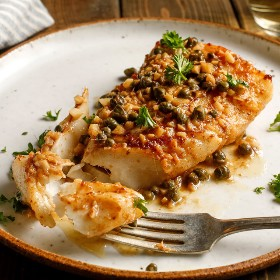

---
categories:
- 135D8DF8-5165-487A-9161-61345003AB1B
- 0E6E410A-45EC-4274-98C8-2190B87DB54A
- 1C21D75E-3CF2-4B23-B04F-A9275BC1033B
- 2BBE169B-4709-4377-8F54-765FFAAD9E1A
cook_time: ''
created: '2024-09-01 14:21:25'
difficulty: ''
hash: 844e0d80a724ba0e678ec172e998bb0dfa120c1a2a823d22e169f9e67f8bbc3d
image_url: https://static01.nyt.com/images/2016/12/19/dining/19COOKING-SEAREDHALIBUT2/19COOKING-SEAREDHALIBUT2-square640.jpg
in_trash: false
is_pinned: false
on_favorites: false
on_grocery_list: false
prep_time: ''
rating: 0
scale: null
servings: 4 servings
source: Cooking.nytimes.com
source_url: https://cooking.nytimes.com/recipes/10603-seared-halibut-with-anchovies-capers-and-garlic?smid=ck-recipe-android-share
total_time: 20 min
uid: 1722D85D-B3C0-46A2-9D7C-F1803100BB7E
---

# Seared Halibut with Anchovies, Capers and Garlic

## Ingredients

- 2 tbsp extra virgin olive oil
- 2 tbsp butter (or more oil)
- 1 1/2-2 lb halibut or swordfish steaks
- Salt and pepper to taste
- 4 anchovy fillets or more to taste
- 1 tbsp or more minced garlic
- 1 tbsp drained capers
- 1/2 cup dry white wine
- 1 tsp lemon juice, or to taste
- Chopped fresh parsley for garnish

## Directions

Heat oven to 400°F. Put a large skillet, preferably nonstick, over medium-high heat, and leave it there until hot. Add oil and butter together. Butter should sizzle. When butter foam subsides, add fish, and season it lightly with salt and pepper. Brown fish, basting with pan juices, then turn, and brown again. Do not worry about cooking through. Turn off heat, put fish on an ovenproof plate, and place it in oven.

Turn heat under skillet to medium, and add anchovies and garlic. Cook, stirring occasionally, until anchovies break up, just a couple of minutes. Add capers and wine, and turn heat to high. Cook until wine is reduced by half. Return fish and its juices to pan, and turn it in sauce once or twice. Fish should be cooked through by now. (A thin-bladed knife inserted into its thickest part will meet little resistance.)

Taste sauce, add some lemon juice, then taste again. It should be strong-tasting but only mildly acidic. Remove fish to serving plate, spoon sauce on top, and garnish with parsley.

## Nutritional Information

Trans Fat: 0 g
Fat: 26 g
Calories: 436
Saturated Fat: 8 g
Unsaturated Fat: 16 g
Sodium: 592 milligrams
Sugar: 0 g
Fiber: 0 g
Carbohydrate: 2 g
Protein: 41 g
