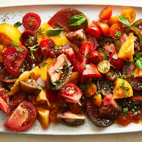

---
categories:
- 9B3E8F54-7F9D-4782-919F-ACC9A0850C87
- 60FB6093-F8C4-447B-A9A2-81A75BBCBA70
- 9B27D475-7644-4A83-9A71-DACE79FB649E
- 088012EF-69C0-412F-BD34-160FE5B0E043
cook_time: ''
created: '2023-07-03 15:22:44'
difficulty: ''
hash: c8ecbc157359d82017e77d749e3d19aa05abf62551d326763bd0fd91c4845902
image_url: https://static01.nyt.com/images/2023/05/18/multimedia/18MAKE-AHEAD-SALADSrex5-tomato-zhtw/18MAKE-AHEAD-SALADSrex5-tomato-zhtw-mediumSquareAt3X.jpg
in_trash: false
is_pinned: false
on_favorites: false
on_grocery_list: false
prep_time: ''
rating: 0
scale: null
servings: 6-8 servings
source: Cooking.nytimes.com
source_url: https://cooking.nytimes.com/recipes/1024154-sesame-tomato-salad
total_time: 20 min
uid: 6EB7E359-0423-49E2-9336-7272878D5BA8
---

# Sesame Tomato Salad

## Ingredients

- 1/2 cup extra-virgin olive oil
- 6 tbsp low-sodium soy sauce
- 2 tbsp distilled white vinegar
- 2 tbsp toasted sesame oil
- 1 tsp minced garlic
- 1 tsp granulated sugar, plus more to taste
- 3 lb mixed tomatoes, large tomatoes chopped or sliced and small tomatoes halved
- Kosher salt (such as Diamond Crystal) and black pepper
- 1/4 cup chopped basil

## Directions

In a medium bowl, combine olive oil, soy sauce, vinegar, sesame oil, garlic and sugar; whisk to combine.

Arrange the tomatoes on a serving platter and season with salt and pepper. Drizzle with half of the dressing and top with basil. Serve the remaining dressing on the side.

## Nutritional Information

Trans Fat: 0 g
Fat: 18 g
Calories: 223
Saturated Fat: 2 g
Unsaturated Fat: 14 g
Sodium: 870 milligrams
Sugar: 10 g
Fiber: 4 g
Carbohydrate: 15 g
Protein: 4 g
