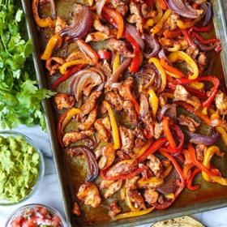

---
categories:
- 135D8DF8-5165-487A-9161-61345003AB1B
- E131025A-19E9-4C5F-99A8-75EE51F165D8
- 3C8ADFAF-87C1-4C30-AA13-572072B4B626
- 2BBE169B-4709-4377-8F54-765FFAAD9E1A
cook_time: 25 minutes
created: '2021-09-01 11:53:38'
difficulty: ''
hash: 1764cc8a7c294e8ac67d21d8a31edfb4e41d06abcf9e8f7c3886b382bc77f0b1
image_url: https://s23209.pcdn.co/wp-content/uploads/2019/07/Sheet-Pan-Chicken-FajitasIMG_9933-600x900.jpg
in_trash: false
is_pinned: false
on_favorites: false
on_grocery_list: false
prep_time: 20 minutes
rating: 0
scale: null
servings: 6 servings
source: damndelicious.net
source_url: https://damndelicious.net/2019/07/24/sheet-pan-chicken-fajitas/
total_time: ''
uid: BFE2F283-4F73-4AE2-82C5-4589F99B1F0A
---

# Sheet Pan Chicken Fajitas

## Ingredients

- 2 tsp chili powder
- 2 tsp ground cumin
- 2 tsp dried oregano
- 3/4 tsp paprika
- 1/4 tsp smoked paprika
- pinch of cayenne powder
- Kosher salt and freshly ground black pepper, to taste
- 1 1/2 lb boneless, skinless chicken breasts, cut into thin strips
- 1 red bell pepper, cut into strips
- 1 yellow bell pepper, cut into strips
- 2 medium red onions, cut into wedges
- 3 garlic cloves, grated
- 3 tbsp olive oil
- 1/4 cup chopped fresh cilantro leaves
- 2 tbsp freshly squeezed lime juice
- 6 (8-inch) flour or corn tortillas, warmed

## Directions

Preheat oven to 425°F. Lightly oil a baking sheet or coat with nonstick spray.

In a small bowl, combine chili powder, cumin, oregano, paprika, 1 1/4 tsp salt and 1 1/4 tsp pepper. Add enough olive oil to make into thick sauce. Grate in garlic and mix well.

Place chicken, bell peppers, onion and garlic in a single layer onto the prepared baking sheet. Stir in olive oil and chili powder mixture; gently toss to combine.

Place into oven and bake for 25 minutes, or until the chicken is completely cooked through and the vegetables are crisp-tender. Stir in cilantro and lime juice.

Serve immediately with tortillas.
