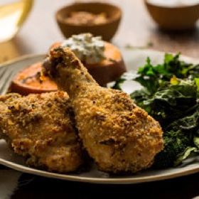

---
categories:
- 135D8DF8-5165-487A-9161-61345003AB1B
- E131025A-19E9-4C5F-99A8-75EE51F165D8
- 3C8ADFAF-87C1-4C30-AA13-572072B4B626
- 2BBE169B-4709-4377-8F54-765FFAAD9E1A
cook_time: 1 1/4 hours
created: '2021-01-24 13:46:18'
difficulty: ''
hash: ef08f9ac160928fee8321609ff6a3d1a59ba18bd6d4be9aedb51737dfecf5bec
image_url: https://static01.nyt.com/images/2014/01/31/multimedia/clark-roasted-chicken/clark-roasted-chicken-videoHpMedium-v2.jpg
in_trash: false
is_pinned: false
on_favorites: false
on_grocery_list: false
prep_time: ''
rating: 0
scale: null
servings: Yield 4 servings
source: cooking.nytimes.com
source_url: https://cooking.nytimes.com/recipes/1016020-sheet-pan-supper?smid=ck-recipe-iOS-share
total_time: ''
uid: C41E2B04-A7A3-4D02-A1D0-B53C43466CB8-1254-000000BEF8E78614
---

# Sheet Pan Supper

## Ingredients

- 1 ½ pounds sweet potatoes (2 medium potatoes)
- 2 teaspoons chopped thyme leaves, plus a small bunch of thyme sprigs
- ¼ cup whole-grain mustard
- 4 garlic cloves
- 1 tablespoon unsalted butter, softened
- 2 teaspoons Dijon mustard
- 3 pounds bone-in chicken thighs or drumsticks (or a mixture), patted dry
- 2 ¼ teaspoons kosher salt
- 1 teaspoon black pepper
- ⅔ cup plain dried bread crumbs
- 2 tablespoons extra-virgin olive oil, more for drizzling
- 1 pound broccoli rabe, trimmed
- Pinch red pepper flakes
- ⅓ cup sour cream or Greek yogurt

## Directions

Prepare the sweet potatoes: Heat oven to 425 degrees. Cut the potatoes into 1-inch-thick slices. Reassemble the slices so they look like intact potatoes. Insert a sprig of thyme between each of the slices. Wrap each potato in 2 layers of foil and place on a pie tin or directly on oven rack (seam side up). Bake until very tender, 60 to 75 minutes.

Meanwhile, make the mustard butter for the chicken: In a small bowl, combine the whole-grain mustard and chopped thyme leaves. Mince 2 garlic cloves and stir into the bowl. Take out 1 tablespoon of the mixture; reserve. Add butter and Dijon to remaining mixture in bowl and stir to combine.

Prepare the chicken: Season chicken with 2 teaspoons salt and 1 teaspoon black pepper. Rub mustard butter all over chicken. Place bread crumbs in a wide, shallow bowl. Coat the chicken evenly with bread crumbs. Transfer to a baking sheet and drizzle with olive oil.

Once the sweet potatoes have baked for a half-hour, add the pan with chicken to the oven and bake until chicken is golden and no longer pink, 35 to 40 minutes.

As the chicken cooks, prepare the broccoli rabe: Toss rabe with olive oil, remaining 1/4 teaspoon salt and the red pepper flakes. Smash remaining 2 garlic cloves and toss into rabe. Spread on another sheet pan. Add to the oven with potatoes and chicken for the last 10 minutes of cooking time. The broccoli rabe is done when the stems are tender and the leaves are crisp at the edges. (The chicken, sweet potatoes and broccoli rabe should all come out of the oven at more or less the same time.)

To serve, combine the reserved 1 tablespoon of mustard mixture with sour cream or yogurt in a small bowl. Serve chicken with broccoli rabe and sweet potatoes on the side, dolloping the potatoes with the sour cream-mustard sauce.

## Nutritional Information

Trans Fat: 0 grams
Fat: 65 grams
Calories: 1074
Saturated Fat: 20 grams
Unsaturated Fat: 39 grams
Sodium: 1597 milligrams
Sugar: 9 grams
Fiber: 10 grams
Carbohydrate: 54 grams
Protein: 66 grams
