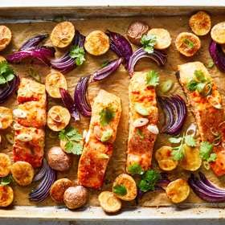

---
categories:
- 135D8DF8-5165-487A-9161-61345003AB1B
- 0E6E410A-45EC-4274-98C8-2190B87DB54A
- 3C8ADFAF-87C1-4C30-AA13-572072B4B626
- 2BBE169B-4709-4377-8F54-765FFAAD9E1A
cook_time: 30 minutes
created: '2020-03-15 19:02:49'
difficulty: ''
hash: 1c7d2a622af59f04ff55bdd599b402de26466b50b800268802ce62c26f946b3c
image_url: https://static01.nyt.com/images/2019/01/28/dining/ch-sheet-pan-salmon-and-potatoes-with-harissa-and-citrus/merlin_145792857_73898966-f0e3-4c7b-9a7d-4eb024fb5e8f-articleLarge.jpg
in_trash: false
is_pinned: false
on_favorites: false
on_grocery_list: false
prep_time: ''
rating: 0
scale: null
servings: Yield 4 servings
source: cooking.nytimes.com
source_url: https://cooking.nytimes.com/recipes/1019962-sheet-pan-harissa-salmon-with-potatoes-and-citrus
total_time: ''
uid: 0DD438CA-E405-4142-8E68-D753A7C35906-52825-000025907D946A54
---

# Sheet-Pan Harissa Salmon with Potatoes and Citrus

## Ingredients

- 4 (6-ounce) skin-on salmon fillets, about 1- to 1½-inches thick
- Kosher salt and black pepper
- 2 to 3 tablespoons mild or spicy harissa paste, depending on your preference
- 2 teaspoons grated fresh ginger
- 1 garlic clove, grated
- ½ teaspoon orange zest
- ¼ cup orange juice (from about ½ orange)
- 1 pound small potatoes, such as baby red or fingerlings, cut in half lengthwise
- 1 small red onion, peeled, quartered and cut into ½-inch wedges
- 2 tablespoons olive oil
- ¼ cup cilantro, roughly chopped, both leaves and tender stems
- 3 tablespoons scallions, thinly sliced on an angle, both white and green parts
- Flaky salt, for serving

## Directions

Heat oven to 450 degrees. Lay salmon on a plate, and season with salt and pepper. In a shallow bowl, whisk together harissa, ginger, garlic, orange zest and juice. Spoon the mixture over the flesh and sides of the fish, and let marinate at room temperature.

Meanwhile, line a sheet pan with parchment paper (or use a nonstick sheet pan). In a large bowl, toss together the potatoes and onion with the olive oil, and season well with salt and pepper. Arrange them on the sheet pan in 1 layer, leaving 4 spaces for the salmon fillets to be added later. Roast until the potatoes are beginning to brown and are almost cooked through, about 20 minutes.

Add the salmon to the sheet pan skin-side down, and roast until the fish is opaque and cooked through and the potatoes are crisp, about 8 minutes more. Scatter cilantro and scallions over everything, and season with flaky salt.

## Nutritional Information

Calories: 523
Total Carbohydrates: 25 grams
Total Fat: 30 grams
Dietary fiber: 3 grams
Protein: 38 grams
Saturated fat: 6 grams
Sodium: 793 milligrams
Sugar: 3 grams
Unsaturated fat: 11 grams
