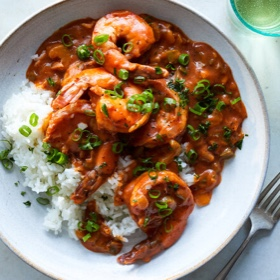

---
categories:
- 135D8DF8-5165-487A-9161-61345003AB1B
- 74D19AD7-7FB6-416E-B539-74DCDC2A820A
- 1A786DC7-9C26-4F71-B6F4-1B452FC14FB9
- 98E4F68D-11D7-4383-90FA-22C804880E1C
cook_time: 50 minutes
created: '2021-01-20 08:46:02'
difficulty: ''
hash: 83309cdb1adc5f137ad53a146bb4ac0ea55d3a39beb6ea868b2d6551d6f410a0
image_url: https://static01.nyt.com/images/2020/12/14/dining/vl-shrimp-creole/vl-shrimp-creole-articleLarge.jpg
in_trash: false
is_pinned: false
on_favorites: false
on_grocery_list: false
prep_time: ''
rating: 0
scale: null
servings: Yield 4 servings
source: cooking.nytimes.com
source_url: https://cooking.nytimes.com/recipes/1021717-shrimp-creole?smid=ck-recipe-iOS-share
total_time: ''
uid: 6D2F371C-C3F4-4CA1-916F-EA4F340EE768-80308-00003BCBC4D25489
---

# Shrimp Creole

## Ingredients

- FOR THE CREOLE SEASONING (OPTIONAL):
- 1 tbsp smoked paprika
- 1 tbsp chili powder
- 1 tsp onion powder
- 1 tsp garlic powder
- 1/2 tsp cayenne pepper (or less, if desired)
- 1/2 tsp fine sea salt
- 1/2 tsp black pepper
- FOR THE SHRIMP:
- 1 lb shrimp, peeled and deveined
- 2 tsp homemade or store-bought Creole seasoning
- 1/4 cup unsalted butter (1/2 stick)
- 1/3 cup all-purpose flour
- 1 medium yellow onion, finely chopped
- 2 celery ribs, thinly sliced
- 1 green bell pepper, seeded and finely chopped
- 4 garlic cloves, minced
- 1 (15 oz) can tomato sauce (no salt added)
- 1-2 tsp hot sauce, to taste (optional)
- 1 tsp granulated sugar
- 1/2 tsp dried thyme
- 1/2 tsp dried oregano
- 1/2 tsp dried basil
- 2 dried bay leaves
- Fine sea salt and black pepper
- 1/4 cup chopped scallions
- 1/4 cup chopped flat-leaf parsley leaves and tender stems
- Steamed rice, for serving

## Directions

Make the optional Creole seasoning: Combine all ingredients in a small bowl and stir together. The seasoning makes about 1/4 cup; store it in a closed container in a cool, dry place.

Toss the raw shrimp with 1 tsp Creole seasoning and set aside.

In a Dutch oven or large, heavy skillet, melt the butter over medium-low heat. Sprinkle the flour on top and stir constantly with a wooden spoon until a roux the color of peanut butter forms, about 10 minutes.

Add the onion, celery and bell pepper, increase the heat to medium and cook until softened, stirring occasionally, about 8 minutes. Stir in the garlic and cook until fragrant, 1 minute.

Stir in 1/3 cup water, then the tomato sauce, hot sauce (if using), sugar, thyme, oregano, basil, bay leaves, 1 1/2 tsp salt, 1/2 tsp black pepper and the remaining 1 tsp Creole seasoning. Bring to a simmer, then reduce the heat to low. Cover and simmer for 10 minutes until thickened, stirring occasionally to make sure that the bottom doesn’t burn. (If needed, add more water.)

Once the stew has thickened, add the seasoned shrimp and simmer until opaque and cooked through, about 5 minutes, turning each piece halfway through the cooking time. Taste and adjust seasoning.

Remove from the heat and let stand for 10 minutes, uncovered. Sprinkle with scallions and parsley, and serve over steamed rice.
