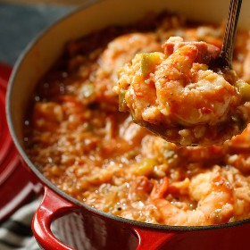

---
categories:
- 135D8DF8-5165-487A-9161-61345003AB1B
- 74D19AD7-7FB6-416E-B539-74DCDC2A820A
- A774024D-4AFA-4EB2-B28E-8925ACA5E85C
- 98E4F68D-11D7-4383-90FA-22C804880E1C
cook_time: ''
created: '2024-10-30 16:37:29'
difficulty: ''
hash: 4698c343149798cbe937179123dfffbe3da0804c62f52fa83bfc2a4a0c9cc378
image_url: https://static01.nyt.com/images/2016/01/19/dining/19COOKING_JAMBALAYA/19COOKING_JAMBALAYA-square640.jpg
in_trash: false
is_pinned: false
on_favorites: false
on_grocery_list: false
prep_time: ''
rating: 0
scale: null
servings: 6 to 8 servings
source: Cooking.nytimes.com
source_url: https://cooking.nytimes.com/recipes/6679-shrimp-jambalaya?smid=ck-recipe-android-share
total_time: 45 min
uid: 8E5F3A8B-EC14-4965-A2A4-8DD5FD4640E7
---

# Shrimp Jambalaya

## Ingredients

- 2 pounds shrimp in the shell
- 2 tablespoons corn, peanut or vegetable oil
- 2 tablespoons flour
- 1 cup finely chopped onion
- 1 cup finely chopped green onions or scallions
- 1 cup finely chopped green pepper
- 1 cup finely chopped celery
- 1 tablespoon finely minced garlic
- 1 cup cooked ham cut into 1/2-inch cubes
- 2 cups crushed imported tomatoes
- 1/2 teaspoon dried thyme
- 1 teaspoon dried crushed oregano
- 1 cup uncooked long-grain rice, optional, or serve the dish with Creole rice (see recipe)
- Salt to taste if desired
- Freshly ground pepper to taste
- 5 cups shrimp broth (see recipe) or water
- 1/2 cup finely chopped green onion or scallions, optional, for garnish

## Directions

Peel and devein the shrimp. The shells may be used to make a broth (see recipe).

Heat the oil in a kettle or large saucepan with a heavy bottom over medium heat. Add the flour, and cook, stirring constantly, until lightly browned. Do not burn.

Add the onion, green onions, green pepper, celery and garlic. Cook, stirring, until wilted. Add ham and stir. Add the tomatoes, thyme and oregano, and bring to a boil. Stir in the uncooked rice, if desired. Add salt, pepper and shrimp broth. Reduce heat to medium-low, and simmer, uncovered, about 25 minutes; add the shrimp and stir. Cook about 10 minutes longer or until it has thickened, but is still slightly soupy. Serve in bowls with chopped green onions on the side as an optional garnish.

## Nutritional Information

Trans Fat: 0 grams
Fat: 9 grams
Calories: 318
Saturated Fat: 2 grams
Unsaturated Fat: 7 grams
Sodium: 984 milligrams
Sugar: 4 grams
Fiber: 2 grams
Carbohydrate: 28 grams
Protein: 31 grams
