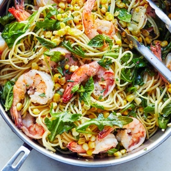

---
categories:
- 135D8DF8-5165-487A-9161-61345003AB1B
- 74D19AD7-7FB6-416E-B539-74DCDC2A820A
- 460F3A6B-0B87-457B-AF84-A1CE51D92D74
- 98E4F68D-11D7-4383-90FA-22C804880E1C
cook_time: 30 minutes
created: '2020-07-17 11:19:43'
difficulty: ''
hash: 30dff0343d43f2047f87a112ddaeb44b0cc07728089a67117132a0c062b91dfe
image_url: https://static01.nyt.com/images/2019/07/16/dining/ch-shrimp-pasta-with-arugula-and-corn/merlin_157887831_c0b688ec-3ba6-4442-81f0-cb3f29eb4a4b-articleLarge.jpg
in_trash: false
is_pinned: false
on_favorites: false
on_grocery_list: false
prep_time: ''
rating: 0
scale: null
servings: Yield 4-6 servings
source: cooking.nytimes.com
source_url: https://cooking.nytimes.com/recipes/1020354-shrimp-linguine-with-herbs-corn-and-arugula
total_time: ''
uid: 06EDB4E4-0C80-42C1-B526-E6F5B0CEBF7E-57272-00001C3D04021AAA
---

# Shrimp Linguine with Herbs, Corn and Arugula

## Ingredients

- Kosher salt
- 12 oz linguine or spaghetti
- 1 lb large shrimp, peeled and deveined, tails removed, if you prefer
- Black pepper
- 1/2 cup unsalted butter (1 stick)
- 2 cups fresh corn kernels (from 2-3 ears)
- 3 garlic cloves, thinly sliced
- 1/2 tsp red-pepper flakes
- 1 cup dry white wine
- 8 oz baby arugula, spinach or other tender greens
- 2 cups loosely packed, roughly chopped tender herbs, such as basil and mint
- Extra-virgin olive oil, for drizzling (optional)

## Directions

Bring a large pot of well-salted water to a boil. Add pasta and cook according to package instructions until it is just short of al dente. Reserve 1 cup of the pasta cooking water, then drain pasta.

While the pasta cooks, season the shrimp well with salt and pepper. Melt half the butter in a deep 12-inch skillet over medium heat. Add the shrimp and sauté until just cooked through, 1-2 minutes per side. Remove and set aside.

Add the corn to the pan and season with salt. Cook, stirring frequently, until browned in spots, 4-5 minutes. Add garlic and red-pepper flakes and cook, stirring frequently, 1 minute.

Add the wine, bring to a simmer and cook until it is reduced by about half, 3-4 minutes. Add the cooked pasta to the skillet and toss to combine. Add the arugula by the handful, stirring well between each addition, until wilted, adding some of the reserved pasta water as needed. Add the remaining butter and the shrimp to the pasta and toss until the butter is melted and everything is coated with sauce. Add more pasta water as needed.

Add half the herbs and toss to combine. Season to taste with salt and pepper. Transfer to a large bowl or serve directly from the skillet. Top with remaining herbs, drizzle with olive oil, if desired, and serve immediately.
