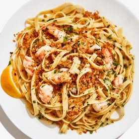

---
categories:
- 135D8DF8-5165-487A-9161-61345003AB1B
- 74D19AD7-7FB6-416E-B539-74DCDC2A820A
- 460F3A6B-0B87-457B-AF84-A1CE51D92D74
- 98E4F68D-11D7-4383-90FA-22C804880E1C
cook_time: ''
created: '2020-01-26 10:32:00'
difficulty: ''
hash: 14418d0b9c89a5b81b328186153f8322ca99eff4ad1dfa24bb3f5d9201f67542
image_url: https://assets.bonappetit.com/photos/5cddd90b634f1e65e14578f9/3:2/w_1880,c_limit/Basically-Shrimp-Scampi-Recipe.jpg
in_trash: false
is_pinned: false
on_favorites: false
on_grocery_list: false
prep_time: ''
rating: 0
scale: ''
servings: 4 servings
source: Bonappetit.com
source_url: https://www.bonappetit.com/recipe/shrimp-scampi-pasta
total_time: ''
uid: FB5E0F86-854E-4D6E-9FE7-49C6A4D14C98
---

# Shrimp Scampi Pasta

## Ingredients

- 1 lb frozen large peeled, deveined shrimp
- Kosher salt
- 1 medium onion
- 7 garlic cloves, divided
- 2 lemons
- 1 cup parsley leaves with tender stems
- 3/4 cup panko (Japanese breadcrumbs)
- 6 tbsp extra-virgin olive oil, divided, plus more for drizzling
- 8 tbsp (1 stick) unsalted butter, divided
- 1/2 tsp red pepper flakes
- 3/4 cup dry white wine
- 1 lb fettuccine

## Directions

Thaw that shrimp! Place unopened 1-lb bag of shrimp in a large bowl and fill with cool water. Place a heavy plate on top to submerge until thawed, about 45 minutes. If you're the kind of person who actually thinks about dinner more than a few hours before you're going to make it, you can also let the shrimp thaw overnight in the fridge. Alternatively, if you're in a hurry, take the shrimp out of the bag and let them soak in a big bowl of cold water—they'll be ready in about 15 minutes. However you thaw them, make sure to pat them dry before proceeding. Season shrimp with 1 tsp salt. Let sit until ready to use. While all that's happening, bring a large pot of salted water to a boil.

This dish comes together quite quickly, so you're going to want to have all of your prep done before you start cooking. Peel 1 medium onion, then finely chop so that all pieces are about the size of lentils. Transfer to a medium bowl. Using a Microplane, grate 5 garlic cloves right into bowl. Finely grate zest of 1/2 lemon right into bowl. Coarsely chop 1 cup parsley leaves with tender stems; transfer to a separate small bowl and set aside.

Slide 1 of 4

PREVIOUS NEXT

Heat 3/4 cup panko, 2 tbsp olive oil, and 1/4 tsp salt in a large Dutch oven over medium, stirring to coat panko.

Grate remaining 2 garlic cloves into pot and stir to combine. Cook, stirring often, until panko is golden brown, 3-4 minutes. Transfer panko mixture to a small bowl. Let cool. Wipe out any panko stuck to bottom of pot.

Heat 2 tbsp olive oil in pot over medium-high until just beginning to shimmer and you can see wisps of smoke. Cook shrimp, undisturbed, until golden brown on the underside, 2-3 minutes. Turn with tongs and continue to cook until shrimp is barely cooked through, about 15 seconds longer (the shrimp will keep cooking as it sits, and we’re going to add them back into the pot later so they’ll get a chance to finish cooking there—err on the side of undercooked). Transfer shrimp to a plate.

Add onion mixture, 4 tbsp butter, 1 tsp salt, and 1/2 tsp red pepper flakes to pot and cook over medium-low heat, stirring frequently, until very fragrant and softened but not browned, about 2 minutes.

Add 3/4 cup dry white wine and bring to a simmer. Cook, stirring occasionally, until most of the liquid evaporates, some of the harsh alcohol scent cooks off, and sauce is thick and glossy, 2-3 minutes. Remove from heat while you cook the pasta.

Drop 1 lb fettuccine in boiling water and set a timer according to package directions for al dente. Scoop out 1 1/2 cups pasta cooking liquid.

Pull off and discard tails of shrimp while pasta cooks, then cut each shrimp into 3 pieces.

Drain pasta and add to Dutch oven along with reserved pasta cooking liquid and remaining 4 tbsp butter and 2 tbsp olive oil. Cook over medium heat, stirring often, until well coated and glossy, about 3 minutes.

Remove pot from heat and stir in shrimp and reserved parsley.

Cut 1 lemon in half and squeeze juice into pot (it should be about 2 tbsp), stirring to combine. Taste and adjust seasoning for salt. Cut remaining lemon into wedges for serving.

Divide pasta among bowls. Drizzle with more olive oil. Top with reserved panko mixture. Serve with lemon wedges alongside.
