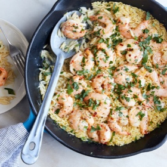

---
categories:
- 135D8DF8-5165-487A-9161-61345003AB1B
- 74D19AD7-7FB6-416E-B539-74DCDC2A820A
- 460F3A6B-0B87-457B-AF84-A1CE51D92D74
- 98E4F68D-11D7-4383-90FA-22C804880E1C
cook_time: 25 minutes
created: '2021-10-24 21:37:48'
difficulty: ''
hash: d666f9ba853175ff0da5c990063ec1a355ccb0fbaba8377a6bdcf8ff3847b51f
image_url: https://static01.nyt.com/images/2021/03/28/dining/11as-shrimp-scampi-with-orzo/11as-shrimp-scampi-with-orzo-articleLarge-v2.jpg
in_trash: false
is_pinned: false
on_favorites: false
on_grocery_list: false
prep_time: ''
rating: 0
scale: null
servings: Yield 4 servings
source: cooking.nytimes.com
source_url: https://cooking.nytimes.com/recipes/1020330-shrimp-scampi-with-orzo
total_time: ''
uid: 01AC1237-4BBA-45C8-98B6-384678D4531A
---

# Shrimp Scampi with Orzo

## Ingredients

- 1 lb large shrimp, peeled and deveined
- 3 tbsp extra-virgin olive oil
- 1 tbsp lemon zest, plus 1 tbsp juice (from 1 lemon)
- 1/2 tsp red-pepper flakes
- Kosher salt and black pepper
- 4 garlic cloves, minced
- 2 tbsp unsalted butter
- 1 cup orzo
- 1/3 cup dry white wine
- 2 cups boiling water, seafood stock or chicken stock
- 3 tbsp finely chopped parsley

## Directions

In a medium bowl, stir together shrimp, 1 tbsp olive oil, lemon zest, red-pepper flakes, 1/2 tsp salt, 1/4 tsp pepper and half the garlic. Set aside to marinate. (This step can be done up to 1 hour in advance.)

Add butter, remaining olive oil and remaining garlic to a medium skillet set over medium heat. When the butter starts to bubble, add the orzo and 1/2 tsp salt and cook, stirring often, until the orzo is toasted, about 2 minutes, adjusting the heat as necessary to prevent the garlic from burning. Carefully add the wine — it will bubble — and stir until absorbed, about 1 minute. Stir in water, reduce heat to low, cover, and cook until orzo is al dente, about 12 minutes.

Add the shrimp in a snug, even layer on top of the orzo, cover, and cook until all the shrimp is pink and cooked through, 2-4 minutes. Remove from heat and let sit, covered, 2 minutes.

Sprinkle with parsley and lemon juice, season with salt and pepper, and serve immediately.
