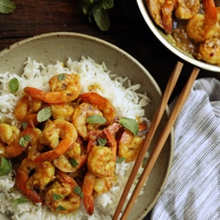

---
categories:
- 135D8DF8-5165-487A-9161-61345003AB1B
- 74D19AD7-7FB6-416E-B539-74DCDC2A820A
- 641901A6-C962-46DC-B418-1C19B51409EF
- 98E4F68D-11D7-4383-90FA-22C804880E1C
cook_time: 30 minutes
created: '2021-03-02 08:18:15'
difficulty: ''
hash: b14096166220041ecad340a7158a792e7daf2f2a97e074c14b959b891dc7c5de
image_url: https://static01.nyt.com/images/2017/01/17/dining/17COOKING-CURRIEDSHRIMP1/17COOKING-CURRIEDSHRIMP1-articleLarge.jpg
in_trash: false
is_pinned: false
on_favorites: false
on_grocery_list: false
prep_time: ''
rating: 0
scale: null
servings: Yield 4 servings
source: cooking.nytimes.com
source_url: https://cooking.nytimes.com/recipes/6515-shrimp-in-yellow-curry?smid=ck-recipe-iOS-share
total_time: ''
uid: 04DA4C34-8725-4852-9EAD-3443AC6D47C8-9653-000002C1B7E2EB87
---

# Shrimp in Yellow Curry

## Ingredients

- 2 tablespoons peanut or vegetable oil
- 1 cup minced onion
- 1 tablespoon minced garlic
- 1 tablespoon minced galangal or ginger
- 1 teaspoon minced hot chili, or crushed red pepper flakes, or to taste
- 1 tablespoon curry powder, or to taste
- 1 cup fresh or canned coconut milk
- 1 ½ to 2 pounds medium-to-large shrimp, peeled
- Salt and freshly ground black pepper
- 2 tablespoons nam pla (fish sauce), or to taste
- ¼ cup minced cilantro or mint leaves

## Directions

Place the oil in a large, deep skillet and turn the heat to medium. Add the onion, garlic, ginger, and chilies and cook, stirring frequently, until the vegetables are tender and the mixture pasty. Add the curry and cook, stirring, another minute.

Add the coconut milk and raise the heat to medium-high. Cook, stirring occasionally, until the mixture is nearly dry. Add the shrimp, a few pinches of salt and a little black pepper and cook, stirring frequently, until the shrimp release their liquid (the mixture will become quite moist again) and turn pink.

Add half the nam pla, stir, then taste and add the rest if necessary. Garnish with cilantro and serve with white or sticky rice.

## Nutritional Information

Trans Fat: 0 grams
Fat: 21 grams
Calories: 348
Saturated Fat: 12 grams
Unsaturated Fat: 8 grams
Sodium: 1856 milligrams
Sugar: 2 grams
Fiber: 2 grams
Carbohydrate: 10 grams
Protein: 30 grams
