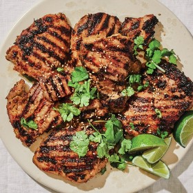

---
categories:
- 135D8DF8-5165-487A-9161-61345003AB1B
- E131025A-19E9-4C5F-99A8-75EE51F165D8
- 1C21D75E-3CF2-4B23-B04F-A9275BC1033B
- 29FDEC25-D5A4-4D29-A800-2D2E46095301
cook_time: ''
created: '2020-01-26 10:30:15'
difficulty: ''
hash: 94ec81e0bb1fa199715787e843cab6e918d0364d3d4c428913722fd408d4e60f
image_url: https://assets.bonappetit.com/photos/5d1cb813e1b4270008a82ec4/16:9/w_1880,c_limit/Print-Summer-Marinade-Chicken.jpg
in_trash: false
is_pinned: false
on_favorites: false
on_grocery_list: false
prep_time: ''
rating: 0
scale: null
servings: 4 servings
source: Bonappetit.com
source_url: https://www.bonappetit.com/recipe/simple-marinated-chicken-thighs
total_time: ''
uid: AFAB946A-A9F9-45BB-B3CA-039670F20088
---

# Simple Marinated Chicken Thighs

## Ingredients

- Vegetable oil (for grill)
- 2 lemongrass stalks, trimmed, tough outer layers removed
- 1 serrano chile
- 3 garlic cloves
- 1 1" piece ginger, peeled
- 1 tbsp dark brown sugar
- 1 tbsp extra-virgin olive oil
- 1 tbsp fish sauce
- 1 tbsp soy sauce
- 1 1/4 lb skinless, boneless chicken thighs
- Kosher salt
- 2 scallions, thinly sliced
- 1/2 cup cilantro leaves with tender stems
- Sesame seeds and lime wedges (for serving)

## Directions

Prepare a grill for high indirect heat (for a gas grill, leave one or two burners off; for a charcoal grill, bank coals on one side); oil grate. Using a Microplane, finely grate lemongrass, chile (seeds and all!), garlic, and ginger into a medium bowl. (Alternatively, you can chop very finely, then mash to a paste using the side of your knife.) Add brown sugar, oil, fish sauce, and soy sauce and mix well.

Season chicken with salt and add to bowl. Turn as needed to coat completely. Let sit at least 10 minutes and up to 2 hours. (If marinating longer, wait to fire up the grill.)

Grill chicken over hottest part of grill, moving to cooler zone as needed if browning too fast, until well browned, about 5 minutes per side. Transfer to a cutting board and let rest 10 minutes before slicing.

Transfer chicken to a platter and top with scallions and cilantro and sprinkle with sesame seeds. Serve with lime wedges for squeezing over.
