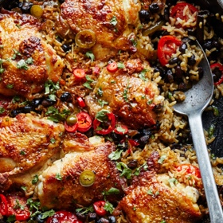

---
categories:
- 135D8DF8-5165-487A-9161-61345003AB1B
- E131025A-19E9-4C5F-99A8-75EE51F165D8
- A774024D-4AFA-4EB2-B28E-8925ACA5E85C
- 2BBE169B-4709-4377-8F54-765FFAAD9E1A
cook_time: ''
created: '2026-03-08 09:33:58'
difficulty: ''
hash: 4c67d89666ab3932203442a6b813b8ad29210c616d6a8492f2108142919e9011
image_url: https://static01.nyt.com/images/2020/10/11/dining/ml-chicken-and-black-beans/ml-chicken-and-black-beans-videoSixteenByNineJumbo1600-v3.jpg
in_trash: false
is_pinned: false
on_favorites: false
on_grocery_list: false
prep_time: ''
rating: 0
scale: null
servings: 4 to 6 servings
source: cooking.nytimes.com
source_url: https://cooking.nytimes.com/recipes/1020457-skillet-chicken-with-black-beans-rice-and-chiles
total_time: 1 hr
uid: 8FDCFAAF-898A-47D7-917E-4CD87DEDA226
---

# Skillet Chicken with Black Beans, Rice and Chiles

## Ingredients

- 8 bone-in, skin-on chicken thighs
- Flaky sea salt and black pepper
- 2 tablespoons extra-virgin olive oil or peanut oil
- 1 large yellow or white onion, chopped
- 2 green or red bell peppers, halved, seeded and sliced
- 2 1/2 cups chicken stock
- 2 red Fresno chiles or jalapeños, halved, seeded and chopped
- 1 (3-inch) cinnamon stick, broken in half
- 3 garlic cloves, finely grated
- 1 teaspoon ground cumin
- 1 (15-ounce) can black beans, rinsed
- 1/3 pound cherry tomatoes, halved
- 1 cup basmati rice, rinsed in a sieve until the water runs clear
- 3 tablespoons chopped cilantro leaves
- Lime wedges, pickled chiles, sliced fresh chiles, sour cream and sliced avocado, for serving

## Directions

Heat the oven to 375 degrees. Season the chicken with salt and pepper on both sides. Heat the oil in a 12-inch ovenproof skillet (the pan size is very important) over medium-high. Brown the chicken on both sides to give it good color, 3 to 5 minutes per side. Transfer to a plate. Add the onion and bell peppers to the pan and sauté until just starting to soften, about 5 minutes. Season with salt and pepper.

In a small saucepan, bring the chicken stock to a boil. Meanwhile, add the Fresno chiles or jalapeños, cinnamon, garlic and cumin to the skillet and cook for about 2 minutes, then add the black beans and cherry tomatoes. Season generously with salt and pepper. Sprinkle the rice on top in an even layer. (It’s important that the black beans are beneath the rice and chicken. The rice will burn otherwise.) Add the stock and return the chicken to the pan, skin-side up.

Bake, uncovered, for 40 minutes. The chicken should be lovely and golden, the stock should be absorbed and the rice should be tender. Sprinkle with the cilantro. Serve with lime wedges, pickled chiles, sliced fresh chiles, sour cream and avocado (squeeze some lime juice over the avocados in a bowl and sprinkle with salt and pepper).

## Nutritional Information

Trans Fat: 0 grams
Fat: 49 grams
Calories: 863
Saturated Fat: 13 grams
Unsaturated Fat: 32 grams
Sodium: 1349 milligrams
Sugar: 6 grams
Fiber: 8 grams
Carbohydrate: 51 grams
Protein: 53 grams
