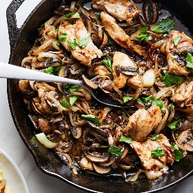

---
categories:
- 135D8DF8-5165-487A-9161-61345003AB1B
- E131025A-19E9-4C5F-99A8-75EE51F165D8
- 1C21D75E-3CF2-4B23-B04F-A9275BC1033B
- 98E4F68D-11D7-4383-90FA-22C804880E1C
cook_time: ''
created: '2025-10-04 22:56:24'
difficulty: ''
hash: 4ef255ae8c702cd85187b133728cb15f282fbc7dbb61065edbe42ab5d4b2112f
image_url: https://static01.nyt.com/images/2021/03/30/dining/yf-chicken-with-mushrooms-and-onions/merlin_185308269_36ffc313-cc76-49cf-b406-3e6e20a4d34f-videoSixteenByNineJumbo1600.jpg
in_trash: false
is_pinned: false
on_favorites: false
on_grocery_list: false
prep_time: ''
rating: 0
scale: null
servings: 4 servings
source: Cooking.nytimes.com
source_url: https://cooking.nytimes.com/recipes/1022068-skillet-chicken-with-mushrooms-and-caramelized-onions?smid=ck-recipe-android-share
total_time: 30 min
uid: 13DD9B73-4D33-4F68-9861-E095AC77B32B
---

# Skillet Chicken with Mushrooms and Caramelized Onions

## Ingredients

- 5 tbsp olive oil
- 2 tbsp plus 2 tsp sherry vinegar
- 2 tsp honey
- 1 tsp Dijon mustard
- 1/4 tsp red-pepper flakes
- Kosher salt and black pepper
- 1 1/2 lb boneless, skinless chicken thighs, cut into 3-inch pieces
- 2 medium yellow onions, thinly sliced (about 4 cups)
- 3/4 lb cremini mushrooms, stems removed and thinly sliced (about 4 cups)
- 1/2 cup fresh flat-leaf parsley or dill leaves and fine stems, roughly chopped
- 1/4 cup grated Parmesan or pecorino (optional)
- Bread or cooked pasta, for serving

## Directions

In a large mixing bowl, combine 2 tbsp oil, 2 tbsp vinegar, the honey, mustard, red-pepper flakes and 1 tsp salt; whisk until smooth. Pat the chicken dry and season with salt and pepper, then add to the mixture, coating it well. Set aside at room temperature, stirring it once while you make the onions.

Heat a 12-inch cast-iron or heavy skillet over medium-high until very hot, 1 1/2-2 minutes, then add the onions in an even layer. Season with salt, then cook, mostly undisturbed, for 4 minutes more, stirring every minute or so. Add the mushrooms, season with salt, and stir to combine. (It will look crowded, and that’s OK.) Allow to cook mostly undisturbed until the mushrooms shrink and start to brown, about 4 minutes, stirring every minute or so.

Stir in the remaining 3 tbsp olive oil and allow the onions to cook until they start to color, stirring and lowering the heat as necessary to avoid burning, about 2 minutes. Push the onions and mushrooms to the edges of the skillet, then add the chicken pieces to the center. Pour any remaining marinade (there will be very little) over the onions and mushrooms. Cook undisturbed for 4-5 minutes, then combine the chicken and vegetables and cook, stirring occasionally, until the chicken is cooked through, about 10 minutes more. (Reduce the heat to medium if the onions look like they are burning at any point.)

Add the remaining 2 tsp sherry vinegar, stirring and scraping up anything on the bottom of the skillet. Season to taste with salt.

Remove from the heat and top with the parsley and cheese, if using. Serve with bread or pasta.

## Nutritional Information

Trans Fat: 0 g
Fat: 27 g
Calories: 599
Saturated Fat: 6 g
Unsaturated Fat: 19 g
Sodium: 1249 milligrams
Sugar: 11 g
Fiber: 5 g
Carbohydrate: 44 g
Protein: 45 g
