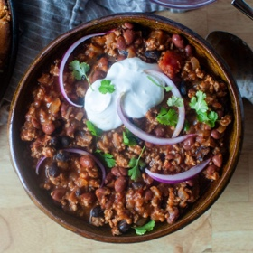

---
categories:
- 135D8DF8-5165-487A-9161-61345003AB1B
- DF723BE7-257E-4E0F-B4AA-BD8B0311B3D8
- 1A786DC7-9C26-4F71-B6F4-1B452FC14FB9
- 98E4F68D-11D7-4383-90FA-22C804880E1C
cook_time: 45 minutes
created: '2020-11-07 08:27:20'
difficulty: ''
hash: c443422b36a41ec7367dad83591a11432db5de6f01b39d3e0b647e8977906569
image_url: https://i0.wp.com/smittenkitchen.com/wp-content/uploads/2020/10/skillet-turkey-chili-scaled.jpg?w=1920&ssl=1
in_trash: false
is_pinned: false
on_favorites: false
on_grocery_list: false
prep_time: ''
rating: 0
scale: null
servings: 'Servings: 4'
source: smittenkitchen.com
source_url: https://smittenkitchen.com/2020/10/skillet-turkey-chili/
total_time: ''
uid: 3310A533-6AC6-4DD4-872D-543982F2D101-6364-000002EF35C64C5B
---

# Skillet Turkey Chili

## Ingredients

- 2 tbsp olive oil
- 1 large onion, chopped small
- 3 garlic cloves, minced
- 2 tsp kosher salt
- 1-3 tsp ground chile powder (see Note; to taste)
- 1 tsp dried oregano
- 1 tsp ground cumin
- 1 lb ground turkey
- 1 (15 oz) can black or small red beans, drained and rinsed
- 1 (15 oz) can diced tomatoes
- 1 lime
- To serve: Sour cream, pickled red onions, pickled jalapenos, grated cheddar, cornbread, fresh cilantro, lime wedges, and/or thinly sliced scallions

## Directions

Heat a large skillet — ideally 11-12 inches in diameter — over medium high heat. Once hot, add the oil and let it warm up. Once the oil is hot, add the onion and cook until somewhat softened, about 4 minutes. Add the garlic, salt, your first tsp chile powder (and more to taste), oregano, and cumin and cook for 1-2 minutes more. Add turkey and use your spatula to break it up and work the onion mixture through it. Cook until lightly browned at edges and no pink remains, about 5 minutes. Add beans and tomatoes and refill empty tomato can with water, setting it aside.

Bring chili mixture to a simmer and cook for 25-30 minutes, stirring regularly. Add reserved can of water, 1/3 at a time, if mixture looks dry. Taste for salt and spice and adjust as needed. With a mild chile powder, I’ll add up to 2 tsp more, and did so here. If you can, let chili rest 5 minutes off heat before serving; I find that the texture sets up nicely. Finish with the juice of half the lime, and any fixings you like.
