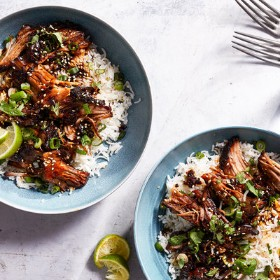

---
categories:
- 135D8DF8-5165-487A-9161-61345003AB1B
- DACC7E83-9563-43BB-A342-86C5AE800BA7
- 1C21D75E-3CF2-4B23-B04F-A9275BC1033B
- 63E2508A-6723-4397-9696-DC45DB21A332
cook_time: ''
created: '2022-12-11 12:53:05'
difficulty: ''
hash: 11a7186426f4ff951bb5d405a54be1d976a07c5ebbabfe3caffd319ad52cd321
image_url: https://static01.nyt.com/images/2020/03/04/dining/sdg-soy-honey-braised-pork/merlin_170016639_cd25e8e8-0597-42f4-9504-c0fe53fd41b2-articleLarge.jpg
in_trash: false
is_pinned: false
on_favorites: false
on_grocery_list: false
prep_time: ''
rating: 0
scale: null
servings: 6 to 8 servings
source: Cooking.nytimes.com
source_url: https://cooking.nytimes.com/recipes/1020923-slow-cooker-honey-soy-braised-pork-with-lime-and-ginger
total_time: 8 hr 20 min
uid: 9B7607DA-5865-492F-8FA7-B1B101E9C611
---

# Slow Cooker Honey-Soy Braised Pork with Lime and Ginger

## Ingredients

- 3 to 4 pounds boneless, skinless pork shoulder, trimmed of big hunks of fat and cut in half
- 8 large garlic cloves, finely chopped
- 3 tablespoons minced fresh ginger (from one 3-inch piece)
- 1 teaspoon red-pepper flakes, plus more to taste
- 2 teaspoons finely grated lime zest and 2 tablespoons juice (from 1 lime), plus more lime wedges for serving
- 1 cup tamari or low-sodium soy sauce (see Tip)
- 1 cup honey
- 1 tablespoon toasted sesame oil
- Cooked rice, noodles or lettuce cups, for serving
- Toasted sesame seeds, sliced scallions and chopped cilantro, for topping

## Directions

Place the pork in a 6- to 8-quart slow cooker. Scatter the garlic, ginger, red-pepper flakes and lime zest over the top. In a liquid measuring cup, whisk together the tamari, honey and sesame oil, then pour it over the pork. Using tongs, turn to coat all sides of the pork in the sauce, and spoon some over the top so that some of the garlic and ginger is on top of the pork. Cover and cook on low until the pork is very tender and shreds easily with a fork, 8 to 9 hours; it will hold well on warm. (If you are home and able to flip the pork once during cooking, that will help the flavors distribute evenly on the meat and make the color uniform. If not, it will be fine.)

Using tongs, transfer the pork from the slow cooker to a serving platter or large, shallow serving bowl. Using a ladle, skim excess fat off the surface of the cooking liquid, if desired. Carefully pour the sauce into a large pot. Bring the sauce to a boil over medium-high heat and let it simmer until reduced and slightly syrupy, 15 to 20 minutes. Meanwhile, coarsely shred the pork using two forks.

Sprinkle the lime juice over the top of the meat. Drizzle about half the sauce over the top of the shredded meat, tossing to evenly combine. Serve over rice or noodles or in lettuce cups. Top with sesame seeds, scallions and cilantro. Pass the remaining sauce at the table, if desired, as well as extra lime wedges and red-pepper flakes.
