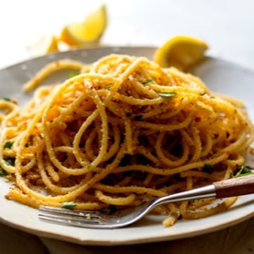

---
categories:
- 135D8DF8-5165-487A-9161-61345003AB1B
- 0E6E410A-45EC-4274-98C8-2190B87DB54A
- 460F3A6B-0B87-457B-AF84-A1CE51D92D74
- 98E4F68D-11D7-4383-90FA-22C804880E1C
cook_time: 30 minutes
created: '2020-06-08 19:46:55'
difficulty: ''
hash: 4f7fdfe8066e7d6e8c20d38526bea5dd211c7e50ee3c1e3383b7ee066fe41c05
image_url: https://static01.nyt.com/images/2014/04/18/multimedia/clark-spaghetti-bread/clark-spaghetti-bread-mediumThreeByTwo440.jpg
in_trash: false
is_pinned: false
on_favorites: false
on_grocery_list: false
prep_time: ''
rating: 0
scale: null
servings: Yield 4 servings
source: cooking.nytimes.com
source_url: https://cooking.nytimes.com/recipes/1016264-spaghetti-with-garlicky-bread-crumbs-and-anchovies
total_time: ''
uid: BC2CEB0C-688D-42B2-8B8A-6D7672A1B5A2-1611-000001650420DB67
---

# Spaghetti with Garlicky Bread Crumbs and Anchovies

## Ingredients

- ⅓ cup extra-virgin olive oil, more as needed
- 12 anchovies, chopped
- 6 garlic cloves, minced
- ¼ teaspoon red pepper flakes
- 1 cup good dried bread crumbs
- Black pepper and kosher salt, as needed
- 1 pound spaghetti
- 2 egg yolks
- 1 tablespoon Asian fish sauce (optional)
- 1 teaspoon hot sauce, such as Tabasco, or to taste
- ½ cup roughly chopped parsley
- Lemon wedges, for serving

## Directions

In a medium skillet over medium-high heat, warm oil. Add anchovies, garlic and red pepper flakes; cook until fragrant, 1 minute. Stir in bread crumbs and cook until golden, 2 to 3 minutes. Season liberally with black pepper, and a little salt if needed.

Bring a large pot of salted water to a boil. Add spaghetti and cook according to package instructions; drain well, reserving some of the pasta water (about 1/2 cup is plenty).

In a large, preferably warmed bowl, stir together egg yolks, fish sauce, hot sauce and 2 tablespoons pasta water. Add hot pasta and toss well, adding more pasta water if the mixture looks dry or unevenly yellow. You want the yolk to evenly coat the pasta but you don’t want it to be soupy. Add bread crumb mixture and parsley and toss well. Season with plenty of black pepper, and salt to taste. Drizzle pasta with more oil just before serving and serve with lemon wedges.
