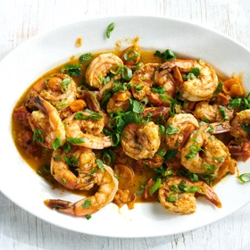

---
categories:
- 135D8DF8-5165-487A-9161-61345003AB1B
- 74D19AD7-7FB6-416E-B539-74DCDC2A820A
- 1C21D75E-3CF2-4B23-B04F-A9275BC1033B
- 98E4F68D-11D7-4383-90FA-22C804880E1C
cook_time: 20 minutes
created: '2020-10-25 10:38:08'
difficulty: ''
hash: c09d7d1cd0df19d35fcdd4d3bbccae6c8a877296713c6cbc993486dba4d9e9d4
image_url: https://static01.nyt.com/images/2020/09/20/dining/11Apperex/merlin_176534631_992abc2b-e91b-410a-b350-3de82a73627e-articleLarge.jpg
in_trash: false
is_pinned: false
on_favorites: false
on_grocery_list: false
prep_time: ''
rating: 0
scale: null
servings: Yield 2-3 servings
source: cooking.nytimes.com
source_url: https://cooking.nytimes.com/recipes/1021430-spiced-ginger-shrimp-with-burst-tomatoes
total_time: ''
uid: CC536982-5EEB-4DD8-86D3-C5683B14C845-69958-000021DA81D590AC
---

# Spiced Ginger Shrimp with Burst Tomatoes

## Ingredients

- About 1 1/2 tsp aromatic spice blend, such as garam masala, Baharat, five-spice, curry powder, or a mild chili powder blend (see Note), plus more to taste
- 1 1/2 tsp finely grated fresh ginger
- 2 garlic cloves, minced or finely grated
- 3 scallions, thinly sliced, greens and whites separated
- 3/4 tsp kosher salt, plus more to taste
- 1/4 tsp black pepper
- 1 lb extra-large shrimp, shelled and deveined
- 1 tbsp extra-virgin olive oil
- 3/4 cup small (or halved large) cherry tomatoes, preferably yellow Sungold tomatoes
- 2 tbsp unsalted butter
- Fresh lime juice
- 1/2 cup fresh mint leaves, torn or roughly chopped

## Directions

In a medium bowl, combine spice blend, ginger, garlic, scallion whites, 1/2 tsp salt and 1/4 tsp pepper. Add shrimp and toss well. Heat a large skillet over high heat, then add the oil. Add the tomatoes and 1/4 tsp salt. Cook until the whole tomatoes burst and the halved ones start to wrinkle, about 2 minutes.

Add shrimp mixture and sauté for another 2-4 minutes, turning the shrimp, until they are pink all over.

Gently stir in butter and cook for another minute, until the shrimp are cooked through. Remove from heat and add a squeeze of fresh lime juice. Taste and add more salt and spices, if needed. Garnish with mint and scallion greens and serve immediately.
