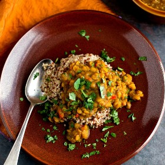

---
categories:
- 135D8DF8-5165-487A-9161-61345003AB1B
- F0D08EC3-D9EF-4F02-A381-FF3D38660DA6
- 641901A6-C962-46DC-B418-1C19B51409EF
- 98E4F68D-11D7-4383-90FA-22C804880E1C
cook_time: ''
created: '2023-12-03 16:51:01'
difficulty: ''
hash: 721478c70cf81762e742cf3189bc2511f50e266c76dd90f4af26a50ecae6470e
image_url: https://static01.nyt.com/images/2013/01/01/science/31recipehealth/31recipehealth-square640.jpg
in_trash: false
is_pinned: false
on_favorites: false
on_grocery_list: false
prep_time: ''
rating: 0
scale: null
servings: 4 to 6 servings
source: Cooking.nytimes.com
source_url: https://cooking.nytimes.com/recipes/1014450-spiced-yellow-lentils-with-quinoa?smid=ck-recipe-android-share
total_time: 1 hr 30 min
uid: 503278C9-7516-415E-830F-78C72CC98F3B
---

# Spiced Yellow Lentils with Quinoa

## Ingredients

- 3/4 cup regular blond quinoa
- 1/4 cup red quinoa
- 1 1/4 cups water
- 1/2 to 3/4 teaspoon salt, to taste
- 1 cup brown or split yellow lentils (toor dal), rinsed
- 1 teaspoon minced fresh ginger
- 1 1/2 teaspoons turmeric
- 1/2 medium onion (intact), peeled
- Salt to taste
- 1 1/2 tablespoons fresh lime juice or 1/4 cup tamarind water (made from soaking 1 tablespoon tamarind paste in warm water for 10 minutes; optional)
- 2 tablespoons grape seed oil, canola oil, safflower oil or sunflower oil
- 1/2 cup finely minced red bell pepper
- 1 plump garlic clove, minced
- 1 teaspoon cumin seeds
- Cayenne pepper to taste
- 3 tablespoons chopped cilantro

## Directions

Rinse the quinoa thoroughly and combine with the water and salt in a large saucepan. Bring to a boil, cover and reduce the heat to low. Simmer 15 to 20 minutes, until the white quinoa displays a little white spiral. Turn off the heat, remove the lid and place a dish towel over the top of the pot. Return the lid and let sit for 15 minutes. The quinoa will now be fluffy. Keep warm.

Meanwhile, combine the lentils, ginger, turmeric and onion half (don’t chop it) with 1 quart water and salt to taste (about 1 to 1 1/2 teaspoons) and bring to a gentle boil. Stir only once to make sure there are no lentils sticking to the bottom of the pot. Reduce the heat to medium – the lentils should simmer briskly – and cook uncovered until the lentils are tender, 30 to 40 minutes. Stir in the lime juice or tamarind concentrate and add another 1/2 cup water. Stir together and simmer for another minute. Turn off the heat and using an immersion blender, an Indian mathani (a wooden tool used for mashing dal) or a wooden Mexican hot chocolate mixer, partially pureé the dal. It should be thick but not like a pureed soup.

Heat the oil over medium-high heat in a small saucepan or small frying pan (such as an 8-inch omelet pan). Add the cumin seeds and allow to sizzle, stirring, for 10 seconds. Add the garlic and cook until lightly colored, about 15 seconds. Add the red pepper and cook until slightly softened, about 1 minute. Remove from the heat and pour over the lentils. Add the cayenne pepper and 1 tablespoon of the cilantro and stir gently. Taste and adjust seasoning.

Serve the quinoa with the dal spooned on top. Garnish with chopped fresh cilantro.

## Notes

Advance preparation: The cooked quinoa and the cooked lentils will keep for 3 or 4 days in the refrigerator. Wait until you reheat before blending the lentils or they will become too solid.

## Nutritional Information

Trans Fat: 0 grams
Fat: 7 grams
Calories: 270
Saturated Fat: 1 gram
Unsaturated Fat: 6 grams
Sodium: 330 milligrams
Sugar: 2 grams
Fiber: 6 grams
Carbohydrate: 41 grams
Protein: 12 grams
