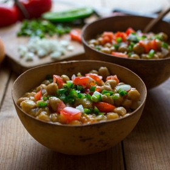

---
categories:
- 135D8DF8-5165-487A-9161-61345003AB1B
- F0D08EC3-D9EF-4F02-A381-FF3D38660DA6
- 641901A6-C962-46DC-B418-1C19B51409EF
- 98E4F68D-11D7-4383-90FA-22C804880E1C
cook_time: 1 hour 45 minutes
created: '2020-08-12 14:08:22'
difficulty: ''
hash: 25d8f953523ab90d0dbcf476269f328b4915e57fde6d5f4842bd1699e3059da9
image_url: https://static01.nyt.com/images/2015/04/29/dining/spicy-chickpeas/spicy-chickpeas-articleLarge.jpg
in_trash: false
is_pinned: false
on_favorites: false
on_grocery_list: false
prep_time: ''
rating: 0
scale: null
servings: Yield 4 servings
source: cooking.nytimes.com
source_url: https://cooking.nytimes.com/recipes/1335-spicy-chickpeas-with-ginger
total_time: ''
uid: 7B1D4054-7081-4536-B3AE-8D4A71167B7E-84199-00002AE18E0833EA
---

# Spicy Chickpeas with Ginger

## Ingredients

- FOR THE CHICKPEAS:
- 1 ½ cups dried chickpeas, soaked overnight
- 4 garlic cloves
- 2 sprigs parsley
- 1 onion, quartered
- 1 tablespoon olive oil
- 2 teaspoons sea salt
- FOR THE SAUCE:
- 3 tablespoons mustard oil or vegetable oil
- 1 large onion, finely diced
- 1 bay leaf
- 3 garlic cloves
- 2 tablespoons grated ginger
- 2 teaspoons ground coriander
- 2 teaspoons ground cumin
- ¼ teaspoon ground cardamom
- ½ teaspoon salt
- ½ teaspoon freshly ground black pepper
- 3 tomatoes, peeled and diced
- 1 ½ cups chickpea broth or water
- Juice of 1/2 lemon
- 2 tablespoons diced onion
- 1 teaspoon minced jalapeno pepper
- 2 tablespoons chopped cilantro

## Directions

Drain the chickpeas. Put them in a saucepan, cover with 3 quarts fresh water, and boil for 10 minutes. Skim off any foam that collects on the surface, then lower the heat. Add the garlic, parsley, onion and oil. Simmer, partly covered, until the peas are almost tender, about 45 minutes. Add the salt, and continue cooking until the peas are completely tender but not mushy, about 30 minutes more. Strain, reserving the broth. This should yield about 3 cups chickpeas.

For the sauce, warm the oil in a large skillet over medium heat. Add the onion, and cook, stirring frequently, until well browned, 12 to 15 minutes. Lower the heat, and add the bay leaf, garlic, ginger, spices, salt, pepper and two-thirds of the diced tomatoes. Cook for 5 minutes.

Add the reserved chickpea broth and the chickpeas. Simmer until the liquid is reduced to a saucelike consistency. Adjust the seasonings, and add lemon juice to taste. Serve accompanied by the remaining diced tomato, diced onion, minced jalapeno and chopped cilantro or scatter them over the chickpeas.
