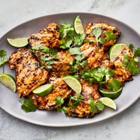

---
categories:
- 135D8DF8-5165-487A-9161-61345003AB1B
- E131025A-19E9-4C5F-99A8-75EE51F165D8
- 1C21D75E-3CF2-4B23-B04F-A9275BC1033B
- 29FDEC25-D5A4-4D29-A800-2D2E46095301
cook_time: ''
created: '2021-08-26 18:24:31'
difficulty: ''
hash: 8191dc41e170b3269619ca017629da0a97440254427301cf819b65a2baf6ffcf
image_url: https://assets.bonappetit.com/photos/5d1232c5a99ac2f8c7ab8596/1:1/w_2560%2Cc_limit/Coconut-Grilled-Chicken-Thighs-lede.jpg
in_trash: false
is_pinned: false
on_favorites: false
on_grocery_list: false
prep_time: ''
rating: 0
scale: null
servings: 4 servings
source: bonappetit.com
source_url: https://www.bonappetit.com/recipe/spicy-coconut-grilled-chicken-thighs
total_time: ''
uid: ABF727A1-5DE6-453F-85B8-BF8209BC4A82
---

# Spicy Coconut Grilled Chicken Thighs

## Ingredients

- 1 3" piece fresh ginger
- 5 garlic cloves
- 3/4 cup coconut milk
- 1/4 cup hot chili paste (such as sambal oelek)
- 1/4 cup fresh lime juice
- 2 tbsp light brown sugar
- 1 tbsp Diamond Crystal or 1 3/4 tsp Morton kosher salt
- 2 tbsp vegetable oil, plus more for grill
- 2 lb skinless, boneless chicken thighs
- 1/2 cup cilantro leaves with tender stems
- Lime wedges (for serving)

## Directions

Prepare a grill for medium heat. Finely grate ginger and garlic into a medium bowl. Add coconut milk, chili paste, lime juice, brown sugar, salt, and 2 tbsp oil and whisk to combine. Add chicken and toss to coat. Let sit at least 15 minutes or up to 4 hours.

Remove chicken from marinade, letting excess drip back into bowl, and transfer to a rimmed baking sheet. Pour marinade into a small saucepan. Bring to a boil, then reduce heat to medium-low and simmer, stirring occasionally, until slightly reduced and thick enough to coat the back of a spoon, 2-3 minutes.

Clean and generously oil grate of grill (if there are a few flare-ups while you do so, not to worry, they will burn off). Grill chicken, turning once and basting occasionally with marinade, until you see some good grill marks and chicken is cooked through, 8-10 minutes.

Transfer chicken to a platter. Brush with remaining marinade. Top with cilantro and serve with lime wedges alongside.
