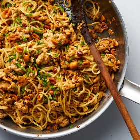

---
categories:
- 135D8DF8-5165-487A-9161-61345003AB1B
- E131025A-19E9-4C5F-99A8-75EE51F165D8
- 460F3A6B-0B87-457B-AF84-A1CE51D92D74
- 98E4F68D-11D7-4383-90FA-22C804880E1C
cook_time: ''
created: '2023-07-07 18:47:28'
difficulty: ''
hash: 7e30952ae14c657749990fd2c636c4333c87ce037a702c1a8e599569360ae2bc
image_url: https://static01.nyt.com/images/2019/12/18/dining/as-sesame-noodles/merlin_165769617_7f8cc187-825d-4114-ba1a-34c342286a07-videoSixteenByNineJumbo1600.jpg
in_trash: false
is_pinned: false
on_favorites: false
on_grocery_list: false
prep_time: ''
rating: 0
scale: null
servings: 4 servings
source: Cooking.nytimes.com
source_url: https://cooking.nytimes.com/recipes/1020732-spicy-sesame-noodles-with-chicken-and-peanuts?smid=ck-recipe-android-share
total_time: 30 min
uid: 1996B7F9-1BC7-4C47-B7CF-6014ECA350BD
---

# Spicy Sesame Noodles with Chicken and Peanuts

## Ingredients

- 1 1/2 tbsp red-pepper flakes
- 1 1/2 tbsp low-sodium soy sauce
- 1 1/2 tsp toasted sesame oil, plus more as needed
- Kosher salt and black pepper
- 1/2 cup plus 1 tbsp neutral oil, like grapeseed or vegetable
- 6 tbsp roasted, salted peanuts, coarsely chopped
- Rind of 1/2 orange, peeled into 2-3 inch strips
- 1 lb ground chicken
- 10-12 oz ramen or udon noodles, preferably fresh
- 3 tbsp finely chopped chives

## Directions

In a medium heatproof bowl, stir together the red-pepper flakes, soy sauce and sesame oil. Set next to the stovetop.

Bring a large pot of salted water to boil. Meanwhile, in a large (12-inch) skillet over medium heat, cook the 1/2 cup oil, peanuts and orange rind, shaking the pan occasionally, until the peanuts are golden and bubbling, 3-5 minutes. Immediately pour the contents of the skillet over the red-pepper mixture (be careful of splattering!) and set aside.

Meanwhile, in the same skillet, heat the remaining tbsp oil over medium-high. Add the chicken and press it down with a wooden spoon into a thin layer. Season with salt and a generous amount of black pepper and cook, without stirring, occasionally pressing the layer of chicken down, until the bottom is browned, 5-7 minutes. Break the chicken up into small pieces and cook, stirring occasionally, until cooked through, 1-2 minutes more.

While the chicken cooks, cook the noodles according to package directions, until chewy but not soft. Drain and toss with a bit of sesame oil.

Remove and discard the orange rind from the chile oil. Off the heat, add enough chile oil to coat the chicken and stir, scraping up any browned bits from the pan. Add the noodles and toss, adding more chile oil to fully coat the noodles and chicken. (If you don't use all of the chile oil, you can store it in the refrigerator for 2 weeks in an airtight container.) Top with chives and serve at once.

## Nutritional Information

Trans Fat: 0 g
Fat: 19 g
Calories: 564
Saturated Fat: 4 g
Unsaturated Fat: 13 g
Sodium: 532 milligrams
Sugar: 3 g
Fiber: 5 g
Carbohydrate: 64 g
Protein: 34 g
