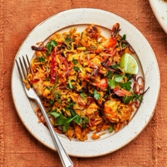

---
categories:
- 135D8DF8-5165-487A-9161-61345003AB1B
- 74D19AD7-7FB6-416E-B539-74DCDC2A820A
- A774024D-4AFA-4EB2-B28E-8925ACA5E85C
- 98E4F68D-11D7-4383-90FA-22C804880E1C
cook_time: ''
created: '2021-04-17 14:52:35'
difficulty: ''
hash: 93f2c57b248a6f4dc5da3665ce0c977d3229bdc1b978ea96a1bfe8d33462729a
image_url: https://assets.bonappetit.com/photos/6048f5c9b5ad3ffa9fef04d7/1:1/w_2560%2Cc_limit/Comfort-Spicy-Shrimp-Pilaf.jpg
in_trash: false
is_pinned: false
on_favorites: false
on_grocery_list: false
prep_time: ''
rating: 0
scale: null
servings: 4 servings
source: bonappetit.com
source_url: https://www.bonappetit.com/recipe/spicy-shrimp-pilaf
total_time: ''
uid: 7543895F-081C-4C36-9BB5-239555863677
---

# Spicy Shrimp Pilaf

## Ingredients

- ¼ cup plus 2 Tbsp. ghee or vegetable oil
- 2 medium red onions, thinly sliced
- 1½ tsp. Diamond Crystal or 1 tsp. Morton kosher salt, plus more
- 4 whole dried chiles de árbol or 1 tsp. crushed red pepper flakes
- 2 Tbsp. double-concentrated tomato paste
- 4 tsp. ground coriander, divided
- 2 tsp. freshly ground black pepper, divided
- 1 tsp. ground turmeric, divided
- 1½ cups basmati rice, rinsed until water runs clear
- 1 lb. large shrimp, peeled, deveined
- 3 garlic cloves, finely grated
- 2 tsp. finely grated ginger
- ½ cup coarsely chopped cilantro, dill, or mint
- Lime wedges (for serving)

## Directions

Melt ¼ cup ghee in a medium pot over medium heat. Add onions, season with salt, and cook, stirring occasionally, until deeply golden brown and starting to look lacy (this will take some time!), 15–20 minutes. Using a slotted spoon, transfer half of the onions to a plate and set aside for serving.

Add chiles de árbol, tomato paste, 2 tsp. coriander, 1 tsp. pepper, and ½ tsp. turmeric to onions still in pot. Cook, stirring often, until tomato paste darkens slightly, about 3 minutes. Add rice and cook, stirring, until each grain is well coated, about 30 seconds. Add 1½ tsp. salt, pour in 2¼ cups water, and give mixture a stir to prevent any grains from sticking to bottom of pot. Bring to a boil, then reduce heat to low and cover pot. Let rice cook until water is completely absorbed and rice is tender, 16–18 minutes. Remove pot from heat and let rice sit (still covered) 15 minutes.

While the rice is resting, toss shrimp with garlic, ginger, remaining 2 tsp. coriander, 1 tsp. pepper, and ½ tsp. turmeric in a medium bowl. Season with salt and toss again.

Five minutes before rice is done resting, melt remaining 2 Tbsp. ghee in a large nonstick skillet over medium-high heat. Add shrimp in a single layer and cook until lightly charred around the edges, about 1 minute per side. Remove from heat.

Uncover rice and fluff with a fork. Add shrimp and cilantro and gently fold in until evenly distributed. Transfer pilaf to a platter and top with reserved crispy onions. Serve pilaf with lime wedges for squeezing over.
