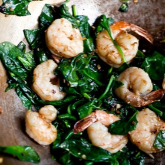

---
categories:
- 135D8DF8-5165-487A-9161-61345003AB1B
- 74D19AD7-7FB6-416E-B539-74DCDC2A820A
- 1C21D75E-3CF2-4B23-B04F-A9275BC1033B
- 98E4F68D-11D7-4383-90FA-22C804880E1C
cook_time: ''
created: '2025-12-29 10:29:09'
difficulty: ''
hash: 25387606d10d26ea4dd654fd1b8ae8a34ac66cad89f31e51169ae6cc4b5515d9
image_url: https://static01.nyt.com/images/2012/04/13/health/nutrition/13recipehealth/13recipehealth-facebookJumbo-v2.jpg
in_trash: false
is_pinned: false
on_favorites: false
on_grocery_list: false
prep_time: ''
rating: 0
scale: null
servings: 3 to 4 servings
source: cooking.nytimes.com
source_url: https://cooking.nytimes.com/recipes/12382-stir-fried-sesame-shrimp-and-spinach
total_time: 15 min
uid: 78485C52-889C-4956-94ED-BB4FC19CFC46
---

# Stir-Fried Sesame Shrimp and Spinach

## Ingredients

- 1 pound large shrimp, peeled and deveined
- Salt to taste
- 1/8 teaspoon sugar
- 2 tablespoons canola oil or light sesame oil
- 1 tablespoon minced ginger
- 1 tablespoon minced garlic
- 1/4 to 1/2 teaspoon crumbled dried red chili
- 2 tablespoons sesame seeds
- 1 generous bunch spinach (about 1 pound), stems trimmed at the end, rinsed in 2 changes water
- 2 teaspoons dark sesame oil

## Directions

Place the shrimp in a large colander and rinse with water. Sprinkle generously with salt and toss together for about a minute. Rinse with water and repeat. After rinsing one more time, drain on paper towels. Pat dry with more paper towels.

Combine 1/4 to 1/2 teaspoon salt (to taste) and the sugar in a small bowl and place close to your wok.

Heat a 14-inch flat-bottomed wok over high heat until a drop of water evaporates within a second or two when added to the pan. Swirl in 1 tablespoon of the oil by adding it to the sides of the pan and swirling the pan, then add the garlic, ginger and chili flakes and stir-fry for no more than 10 seconds. Push to the sides of the pan and add the shrimp in one layer. Let cook undisturbed for 1 minute, then add the remaining oil and stir-fry for 1 minute.

Add the sesame seeds and spinach and stir-fry for 1 minute, until it has begun to wilt but the wilting is still uneven. Add the salt and sugar, sprinkling it evenly over the spinach, and continue to stir-fry until the spinach has wilted but is still bright and the shrimp are cooked through and bright pink, about 2 more minutes. Remove from the heat, drizzle on the sesame oil, toss together and serve, with rice, noodles or other grains.

## Notes

Advance preparation: You can prepare the shrimp through Step 1 several hours ahead.

## Nutritional Information

Trans Fat: 0 grams
Fat: 13 grams
Calories: 235
Saturated Fat: 1 gram
Unsaturated Fat: 11 grams
Sodium: 568 milligrams
Sugar: 1 gram
Fiber: 3 grams
Carbohydrate: 6 grams
Protein: 27 grams
