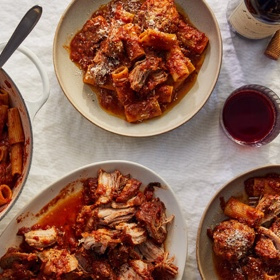

---
categories:
- 135D8DF8-5165-487A-9161-61345003AB1B
- DACC7E83-9563-43BB-A342-86C5AE800BA7
- 460F3A6B-0B87-457B-AF84-A1CE51D92D74
- 98E4F68D-11D7-4383-90FA-22C804880E1C
cook_time: ''
created: '2022-05-16 12:38:44'
difficulty: ''
hash: ceaa13b3c1b9cc14569d2914fb332d35b5179d0ef9864a3b3ea79d9c371d7e23
image_url: https://static01.nyt.com/images/2022/02/08/dining/as-sunday-sauce/merlin_201238980_104949b5-4fa9-4f9d-83a5-c0c7d26a4ec1-articleLarge.jpg
in_trash: false
is_pinned: false
on_favorites: false
on_grocery_list: false
prep_time: ''
rating: 0
scale: null
servings: 6 to 8 servings
source: cooking.nytimes.com
source_url: https://cooking.nytimes.com/recipes/1022972-sunday-sauce?ds_c=71700000052595478&gbraid=0AAAAADwd30jUt-mXtMssbC4BoV5uijKkh&gbraid=0AAAAADwd30jUt-mXtMssbC4BoV5uijKkh&gclid=EAIaIQobChMIquPXubrk9wIV3PHjBx1yUwNgEAAYASAAEgLarfD_BwE&gclsrc=aw.ds
total_time: 3 hr 30 min
uid: 38C9F735-6231-432D-9089-58E441F1A358
---

# Sunday Sauce

## Ingredients

- 2 pounds boneless pork shoulder, cut into 3-inch chunks
- Kosher salt and black pepper
- 1/4 cup extra-virgin olive oil, plus more as needed
- 1 pound hot or sweet Italian sausage, or a combination
- 1 yellow onion, coarsely chopped
- 6 garlic cloves, smashed and peeled
- 1/3 cup red wine
- 2 (28-ounce) cans crushed tomatoes
- 3 basil sprigs
- 1 pound uncooked homemade or store-bought meatballs
- 1 1/2 pounds tubular or long noodles, like rigatoni or spaghetti
- Grated Parmesan or pecorino, for serving

## Directions

Season the pork shoulder all over with salt and pepper. In a large Dutch oven, heat 2 tablespoons oil over medium high. Working in batches if necessary, cook the pork until browned on two sides, 8 to 10 minutes total, adding more oil if the pan looks dry. Transfer pieces to a bowl as they finish. Add the sausages to the pot and cook until browned, 4 to 6 minutes total. Transfer to the bowl.

Reduce the heat to medium-low. Add the remaining 2 tablespoons oil, if needed, and the onion and garlic. Season with salt and pepper, and cook until softened, 2 to 4 minutes. Add the red wine, stir, scrape up the browned bits on the bottom of the pan and cook until the wine is nearly evaporated, 2 to 4 minutes.

Add the tomatoes and basil, then fill one of the 28-ounce cans with water. (You’ll use it in a second.) Return the pork shoulder and sausages to the pot, along with any accumulated juices in the bowl. Nudge them around so they are submerged. Add the meatballs on top, then add enough water from the can to cover the meat. (There’s no need to stir.) Partly cover the pot, bring to a simmer over medium-high heat, then reduce heat to a gentle simmer and cook, stirring occasionally, until the pork shoulder falls apart when shredded with a fork, 2 to 2½ hours.

When you’re ready to eat, bring a large pot of salted water to a boil. Add the pasta to the boiling water and cook according to package instructions until al dente. While the pasta cooks, slice the sausage and shred the pork shoulder. Transfer to a platter along with the meatballs and a few spoonfuls of sauce. Reserve ½ cup pasta water, then drain and add the pasta to the pot of sauce. Over medium heat, toss the pasta with the sauce, adding pasta water as needed until the sauce clings to the pasta.

Divide pasta between bowls, then top with a bit of each meat. Pass the Parmesan and platter of meat at the table.
