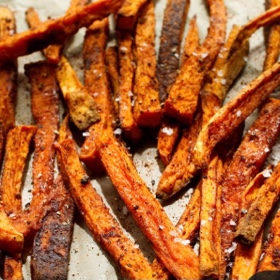

---
categories:
- 9B3E8F54-7F9D-4782-919F-ACC9A0850C87
- 60FB6093-F8C4-447B-A9A2-81A75BBCBA70
- 1C21D75E-3CF2-4B23-B04F-A9275BC1033B
- 2BBE169B-4709-4377-8F54-765FFAAD9E1A
cook_time: 35 minutes
created: '2022-01-11 09:07:16'
difficulty: ''
hash: 32564e88a34c9f16f16a665903f2f6514ae62b3b8da7552a280da2ffdf8f7dd8
image_url: null
in_trash: false
is_pinned: false
on_favorites: false
on_grocery_list: false
prep_time: ''
rating: 0
scale: null
servings: Yield 4-6 servings
source: cooking.nytimes.com
source_url: https://cooking.nytimes.com/recipes/1014647-sweet-potato-fries
total_time: ''
uid: 5735E47E-7A75-451B-A88D-C17BD352FBCC
---

# Sweet Potato Fries

## Ingredients

- 2 lb sweet potatoes, peeled
- 2 tbsp olive oil
- 1 tsp garlic powder
- 1 tsp paprika
- 1 tsp salt
- 1/2 tsp black pepper

## Directions

Heat the oven to 400.

Cut the sweet potatoes into sticks 1/4-1/2 inch wide and 3 inches long, and toss them with the oil.

Mix the spices, salt and pepper in a small bowl, and toss them with the sweet potatoes. Spread them out on 2 rimmed baking sheets.

Bake until brown and crisp on the bottom, about 15 minutes, then flip and cook until the other side is crisp, about 10 minutes. Serve hot.

## Nutritional Information

Fat: 5 g
Calories: 173
Saturated Fat: 1 g
Unsaturated Fat: 4 g
Sodium: 365 milligrams
Sugar: 6 g
Fiber: 5 g
Carbohydrate: 31 g
Protein: 3 g
