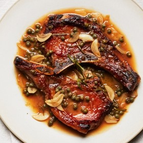

---
categories:
- 135D8DF8-5165-487A-9161-61345003AB1B
- DACC7E83-9563-43BB-A342-86C5AE800BA7
- 1C21D75E-3CF2-4B23-B04F-A9275BC1033B
- 98E4F68D-11D7-4383-90FA-22C804880E1C
cook_time: ''
created: '2020-01-26 10:27:56'
difficulty: ''
hash: 9a62fd70aa93197081465631988dbf477ea08f7001a14f1f20f2ff6e13ccd5c5
image_url: https://assets.bonappetit.com/photos/5d4ddd5c3bde88000879f7ce/16:9/w_1880,c_limit/0919-BA-Sweet-Saucy-Pork-Chop-Playbook.jpg
in_trash: false
is_pinned: false
on_favorites: false
on_grocery_list: false
prep_time: ''
rating: 0
scale: null
servings: 2 servings
source: Bonappetit.com
source_url: https://www.bonappetit.com/recipe/sweet-and-saucy-pork-chops
total_time: ''
uid: 2E88E0A5-8503-4510-AFDB-4B5731ADB9BC
---

# Sweet-And-Saucy Pork Chops

## Ingredients

- 2 1"-thick bone-in pork rib chops
- Kosher salt
- 1½ tsp. sugar, divided
- 2 Tbsp. extra-virgin olive oil, divided
- 1 large shallot, chopped
- 4 garlic cloves, thinly sliced
- ¼ cup red wine vinegar
- 3 sprigs rosemary
- 1 Tbsp. drained capers
- 2 Tbsp. unsalted butter, cut into pieces

## Directions

Season pork chops with salt and sprinkle evenly with ½ tsp. sugar. Heat 1 Tbsp. oil in a large skillet over medium-high. Cook chops, undisturbed, until well browned underneath, about 3 minutes. Turn and cook just until second side is lightly browned, about 1 minute. Transfer chops to a plate (they won’t be fully cooked); reduce heat to medium.

Pour remaining 1 Tbsp. oil into same skillet and add shallot and garlic. Cook, stirring often, until softened and just beginning to brown, about 3 minutes.

Add vinegar and remaining 1 tsp. sugar to skillet. Cook, swirling pan occasionally, until vinegar is nearly evaporated, about 2 minutes.

Add rosemary, capers, and ½ cup water to skillet; season with salt. Reduce heat as needed to maintain a very low simmer. Add butter and swirl pan continuously (and vigorously) until sauce becomes smooth, glossy, and emulsified.

Return pork chops to skillet, arranging darker side up. Simmer gently in sauce, swirling occasionally, until chops are cooked through, about 3 minutes (a thermometer inserted near the bones should register 135°).

Transfer pork chops to plates and spoon sauce over.
