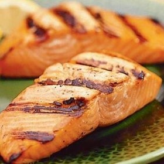

---
categories:
- 135D8DF8-5165-487A-9161-61345003AB1B
- 0E6E410A-45EC-4274-98C8-2190B87DB54A
- 1C21D75E-3CF2-4B23-B04F-A9275BC1033B
- 29FDEC25-D5A4-4D29-A800-2D2E46095301
cook_time: ''
created: '2020-01-26 10:42:20'
difficulty: ''
hash: 80b825bf3a8779d4a89f6d0effa6c12b6392de6ffde455c9304439a64313529a
image_url: https://imagesvc.meredithcorp.io/v3/mm/image?url=https%3A%2F%2Fcdn-image.myrecipes.com%2Fsites%2Fdefault%2Ffiles%2Fstyles%2Fmedium_2x%2Fpublic%2Fimage%2Frecipes%2Fsu%2F07%2F03%2Fbasted-salmon-su-653542-x.jpg%3Fitok%3DO6y4JGBt&w=800&c=sc&poi=face&q=85
in_trash: false
is_pinned: false
on_favorites: false
on_grocery_list: false
prep_time: ''
rating: 0
scale: null
servings: 8 servings
source: Myrecipes.com
source_url: https://www.myrecipes.com/recipe/taku-lodge-basted-grilled-salmon
total_time: ''
uid: 2A82CDE7-4B43-4DB2-AEA5-AFC1244F2DE9
---

# Taku Lodge Basted Grilled Salmon

## Ingredients

- 1/2 cup firmly packed brown sugar
- 1/2 cup dry white wine
- 1/4 cup lemon juice
- About 1/2 teaspoon salt
- About 1/4 teaspoon pepper
- 8 pieces (about 6 oz. each; max. 1 1/4 in. thick) boned, skinned wild salmon fillet
- 1/4 cup (1/8 lb.) butter
- Lemon wedges

## Directions

In a large, wide bowl or 9- by 13-inch baking dish, stir brown sugar, wine, lemon juice, 1/2 teaspoon salt, and 1/4 teaspoon pepper until sugar is dissolved.

Rinse fish and pat dry. Add to marinade and turn to coat. Cover and chill for 1 to 2 hours.

Lift salmon from marinade and transfer to a 12- by 17-inch baking pan. Pour marinade into a 1 1/2- to 2-quart pan over medium-high heat; add butter and stir until butter is melted and mixture is simmering, 4 to 5 minutes.

Lay salmon, skinned side down, on a generously oiled grill over a solid bed of medium-hot coals or medium-high heat on a gas grill (you can hold your hand at grill level only 3 to 4 seconds). Brush fish generously with the baste; close lid if using a gas grill. Cook until salmon pieces are well browned on the bottom, 3 1/2 to 4 minutes (keep a spray bottle filled with clean water on hand to spritz any flare-ups). With a wide spatula, carefully turn pieces; brush tops with baste and continue to cook, basting often, until the salmon is just opaque but still moist-looking in the center of the thickest part (cut to test), about 5 to 6 minutes longer. Discard any remaining baste.

Transfer salmon to a warm platter or plates and garnish with lemon wedges. Add more salt and pepper to taste.

## Nutritional Information

Calories 365
Caloriesfromfat 47%
Protein 36g
Fat 19g
Satfat 5.3g
Carbohydrate 11g
Fiber 0.0g
Sodium 240mg
Cholesterol 117mg
