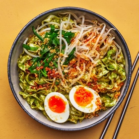

---
categories:
- 135D8DF8-5165-487A-9161-61345003AB1B
- EAB653D6-0540-48C4-B9D0-FD56AE24841E
- 460F3A6B-0B87-457B-AF84-A1CE51D92D74
- 98E4F68D-11D7-4383-90FA-22C804880E1C
cook_time: ''
created: '2021-08-26 18:21:44'
difficulty: ''
hash: f5c57dc14b605093adfc646731214d9cb9bfc2bbbb3ecf4176d412d8d4c9da4e
image_url: https://assets.bonappetit.com/photos/611d14578802063014847313/1:1/w_2560%2Cc_limit/0821-Thai-Basil-Noodles.jpg
in_trash: false
is_pinned: false
on_favorites: false
on_grocery_list: false
prep_time: ''
rating: 0
scale: null
servings: ''
source: bonappetit.com
source_url: https://www.bonappetit.com/recipe/thai-basil-sauce-noodles-with-jammy-egg
total_time: ''
uid: 94416C94-E229-4E41-AB95-81350508FF8F
---

# Thai Basil Sauce Noodles with Jammy Eggs

## Ingredients

- 4 large eggs (optional)
- 1 head of garlic, peeled
- 3 cups Thai basil
- 3/4 cup vegetable oil, divided
- 1/4 cup michiu tou or other rice wine
- 1 tsp sugar
- 1 tsp Diamond Crystal or 1/2 tsp Morton kosher salt, plus more
- 4 garlic chives, cut into 1/2" pieces
- 2 cups mung bean sprouts
- 4 servings dried wide sliced noodles (such as Hsin Tung Yang; about 8 oz)
- Store-bought fried garlic and chili crisp (for serving)

## Directions

If using eggs, bring a large pot of water to a boil over medium-high heat. Using a slotted spoon, carefully lower eggs into water one at a time. Cook 6 1/2 minutes, adjusting heat to maintain a gentle boil. Transfer eggs to a bowl of ice water with slotted spoon; reserve pot with boiling water. Let eggs sit until just slightly warm, about 2 minutes.

Gently crack eggs all over and peel, starting from the wider end, which contains the air pocket. Slice in half and set aside for serving.

Blend raw garlic, Thai basil, and 1/2 cup oil in a blender or food processor until a smooth paste forms.

Heat remaining 1/4 cup oil in a large skillet over medium. Carefully scrape in Thai basil purée and add wine, sugar, and 1 tsp Diamond Crystal or 1/2 tsp Morton kosher salt. Cook, stirring, until fragrant, about 1 minute. Remove from heat and season with more salt if needed.

Return reserved pot of water to a boil. Cook garlic chives and bean sprouts until chives are bright green and sprouts start to turn translucent, about 1 minute. Using slotted spoon, transfer to a small bowl.

Cook noodles in same pot until al dente, about 5 minutes. Drain noodles and transfer to pan with sauce. Using tongs, toss noodles to coat.

Divide noodles among bowls. Top with bean sprouts, garlic chives, fried garlic, and reserved eggs (if using) and drizzle with chili crisp.
