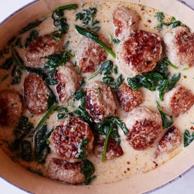

---
categories:
- 135D8DF8-5165-487A-9161-61345003AB1B
- E131025A-19E9-4C5F-99A8-75EE51F165D8
- 1A786DC7-9C26-4F71-B6F4-1B452FC14FB9
- 98E4F68D-11D7-4383-90FA-22C804880E1C
cook_time: 30 minutes
created: '2022-01-02 15:12:58'
difficulty: ''
hash: 58b048c6f519472f19e8b4c4b7fc00d6a446286855cccda1fffd5b147e265d37
image_url: https://static01.nyt.com/images/2019/11/13/dining/as-thai-chicken-meatball-soup/merlin_164331288_f7304b37-3bd7-4a8d-9d3f-d75abdf4df29-articleLarge.jpg
in_trash: false
is_pinned: false
on_favorites: false
on_grocery_list: false
prep_time: ''
rating: 0
scale: null
servings: Yield 4-6 servings
source: cooking.nytimes.com
source_url: https://cooking.nytimes.com/recipes/1020631-thai-inspired-chicken-meatball-soup
total_time: ''
uid: 95F236C4-9448-41FC-96F3-427042B9BF75
---

# Thai-Inspired Chicken Meatball Soup

## Ingredients

- 1 (4-inch) piece fresh ginger, peeled
- 6 garlic cloves, peeled
- 1 jalapeño
- 2 lb ground chicken
- 1 large bunch cilantro, leaves and stems finely chopped, a few whole leaves reserved for serving
- 3 tbsp fish sauce
- Kosher salt
- 2 tbsp vegetable or coconut oil, plus more as needed
- 2 cups chicken broth
- 1 (14 oz) can full-fat coconut milk
- 1/2 tsp granulated sugar
- 5 oz baby spinach
- 1 tbsp lime juice, plus lime wedges for serving
- Steamed white or brown rice, for serving

## Directions

Using the small holes of a box grater, or a Microplane, grate the ginger, garlic and jalapeño (or finely chop them by hand). Transfer half to a large bowl and set the rest aside. To the large bowl, add the chicken, finely chopped cilantro, 2 tbsp fish sauce and 1 tsp salt. Use your hands or a fork to fully combine but do not overmix.

Use your hands or an ice cream scoop to form 2-inch meatballs (about 2 oz each). In a large Dutch oven or pot, heat the oil over medium-high heat. Working in batches, add the meatballs in a single layer and cook, flipping halfway through, until golden brown on two sides, 5-8 minutes. Transfer to a plate and repeat, adding oil as needed.

Once all the meatballs are browned and out of the pot, if the oil is burned, wipe it out and add a bit more to the pot. Reduce the heat to medium, add the reserved ginger mixture and sauté until fragrant, about 1 minute. Add the chicken broth, coconut milk, sugar and the remaining 1 tbsp fish sauce, and bring to a simmer. Add the meatballs and any juices from the plate, and simmer until the flavors come together and the meatballs are cooked through, 5-8 minutes.

Remove from heat, and stir in the spinach and lime juice. Divide rice among bowls, then top with meatballs, broth and cilantro. Serve with lime wedges.
