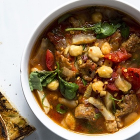

---
categories:
- 135D8DF8-5165-487A-9161-61345003AB1B
- DACC7E83-9563-43BB-A342-86C5AE800BA7
- 1A786DC7-9C26-4F71-B6F4-1B452FC14FB9
- 98E4F68D-11D7-4383-90FA-22C804880E1C
cook_time: ''
created: '2020-03-01 16:18:46'
difficulty: ''
hash: 87a59744dd64a5c6114a6f89006d76241ee5d8d98dbd0039a6bd3e4f846caf28
image_url: https://assets.bonappetit.com/photos/584aea5541f5fb047faf2e38/16:9/w_2560%2Cc_limit/cwar-healthy-ish-dinner-chickpea-soup-lead.jpg
in_trash: false
is_pinned: false
on_favorites: false
on_grocery_list: false
prep_time: ''
rating: 0
scale: null
servings: ''
source: bonappetit.com
source_url: https://www.bonappetit.com/story/healthyish-chickpea-soup-sausage
total_time: ''
uid: 1B16F06D-CE2E-475A-9536-C2EC622F1051-36261-00001AE2B109FC33
---

# The Healthyish Chickpea Soup That, Yep, Still Has Sausage

## Ingredients

- 1 lb sweet italian sausage
- 1 onion 
- 1 fennel bulb
- 4 cloves garlic 
- 2 anchovy filets
- 1/2 tsp. fennel seeds
- 1/2 tsp. red pepper flakes
- 15 oz. cooked chickpeas
- 3 cups chicken stock
- 28 oz. can whole peeled tomatoes
- fresh basil
- fresh oregano
- 2 bay leaves

- loaf of crusty bread for serving

## Directions

First, start with a solid base. Working in a big Dutch oven, brown 1 lb. of store-bought, sweet Italian sausage that's been removed from the casings in 1 or 2 Tbsp. of olive oil, breaking it up into pieces. When it’s cooked through and there’s good caramelization on the pieces, remove the sausage with a slotted spoon and transfer to a bowl. You can omit the meat, but I’d highly recommend using even a little bit so that fat renders enough to to cook chopped aromatics.

Use about 1 onion, 1 fennel bulb, and 4 cloves of garlic (they all go well with the flavors of the sausage, but any combination of aromatics—leek, celery, carrot—could work). Sweat the vegetables for 8 to 10 minutes until they start to brown, then stir in a couple of anchovy filets and about ½ tsp. each of fennel seed and red pepper flakes. Because this is a quick-cooking soup, you want to pack in as much flavor as possible using whatever ingredients you have on hand.

Once the anchovies are dissolved, add a 15-oz. can of rinsed, drained chickpeas along with 3 cups store-bought chicken stock, scraping up the browned bits from the bottom of the pot. Sure, homemade stock and dried cooked beans are better, but when it’s Tuesday and you're hungry, canned beans and store-bought stock are what’s happening. While that comes to a simmer, add a 28-oz. can of whole, peeled tomatoes that you break up with your hands (do this part slowly and right over the pot because the tomatoes will definitely squirt you in the eye or all over whatever clothes are not covered by an apron). Drop in a couple of bay leaves and let the whole pot simmer until the flavors are melded, about 20 minutes.

Then add the sausage back in with chopped fennel fronds, and a few sprigs each of basil and oregano (but it could work with any fresh herb you have in your fridge). To finish, drizzle a little extra olive oil over top, add a dash of red pepper flakes, and serve the soup with crusty bread.

If all goes well, you should be eating a bowl of soup 30 minutes after you start cooking. Everyone needs a quick healthy-ish weeknight dinner in their arsenal—this is mine, and maybe now yours.
