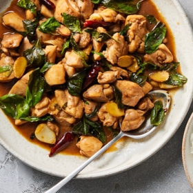

---
categories:
- 135D8DF8-5165-487A-9161-61345003AB1B
- E131025A-19E9-4C5F-99A8-75EE51F165D8
- 1C21D75E-3CF2-4B23-B04F-A9275BC1033B
- 98E4F68D-11D7-4383-90FA-22C804880E1C
cook_time: ''
created: '2024-05-27 13:29:21'
difficulty: ''
hash: 5855875c02a96a0c1f87e1506e5873d8a2145625a913322f810086b5bd76a7d7
image_url: https://static01.nyt.com/images/2024/05/01/multimedia/SS-Three-Cup-Chicken-wqjc/SS-Three-Cup-Chicken-wqjc-square640.jpg
in_trash: false
is_pinned: false
on_favorites: false
on_grocery_list: false
prep_time: ''
rating: 0
scale: null
servings: 4 servings
source: cooking.nytimes.com
source_url: https://cooking.nytimes.com/recipes/1017456-three-cup-chicken
total_time: 30 min
uid: 820BD898-C655-440C-A543-60C7582C0EA7
---

# Three-Cup Chicken

## Ingredients

- 3 tablespoons sesame oil
- 1 2-to-3-inch piece of ginger, peeled and sliced into coins, approximately 12
- 12 cloves of garlic, peeled
- 4 whole scallions, trimmed and cut into 1-inch pieces
- 3 dried red peppers or 1 teaspoon red-pepper flakes
- 2 pounds chicken thighs, boneless or bone-in, cut into bite-size pieces
- 1 tablespoon unrefined or light brown sugar
- 1/2 cup rice wine
- 1/4 cup light soy sauce
- 2 cups fresh Thai basil leaves or regular basil leaves

## Directions

Heat a wok over high heat and add 2 tablespoons sesame oil. When the oil shimmers, add the ginger, garlic, scallions and peppers, and cook until fragrant, approximately 2 minutes.

Scrape the aromatics to the sides of the wok, add remaining oil and allow to heat through. Add the chicken, and cook, stirring occasionally, until it is browned and crisping at the edges, approximately 5 to 7 minutes.

Add sugar and stir to combine, then add the rice wine and soy sauce, and bring just to a boil. Lower the heat, then simmer until the sauce has reduced and started to thicken, approximately 15 minutes.

Turn off the heat, add the basil and stir to combine. Serve with white rice.

## Nutritional Information

Trans Fat: 0 grams
Fat: 48 grams
Calories: 673
Saturated Fat: 12 grams
Unsaturated Fat: 32 grams
Sodium: 764 milligrams
Sugar: 3 grams
Fiber: 1 gram
Carbohydrate: 10 grams
Protein: 40 grams
