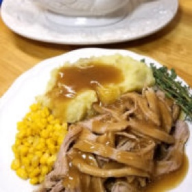

---
categories:
- 135D8DF8-5165-487A-9161-61345003AB1B
- DACC7E83-9563-43BB-A342-86C5AE800BA7
- 1C21D75E-3CF2-4B23-B04F-A9275BC1033B
- 63E2508A-6723-4397-9696-DC45DB21A332
cook_time: 4 hours
created: '2021-09-01 14:23:18'
difficulty: ''
hash: f80ac5a48354025c64a442c977235b7456a06eae118e256b8e4e4e10b5c4965f
image_url: https://sparklesofyum.com/wp-content/uploads/2018/01/trishayearwood_N4-188x300.jpg
in_trash: false
is_pinned: false
on_favorites: false
on_grocery_list: false
prep_time: 15 minutes
rating: 0
scale: null
servings: 'Yield: 8-10 servings'
source: sparklesofyum.com
source_url: https://sparklesofyum.com/trisha-yearwoods-crock-pot-pork-tenderloin/
total_time: ''
uid: 8B61DA7E-8E64-49A5-8713-A3CE664A070D
---

# Trisha Yearwood’s Crock Pot Pork Tenderloin

## Ingredients

- 2 & 1/2-3 lb pork tenderloin, trimmed of all visible fat (you can also use a pork loin, and get the same results)
- 1 tsp granulated garlic powder
- 1/4 tsp ground ginger
- 1/2 tsp dried thyme
- 1/2 tsp black pepper
- 1 tbsp vegetable oil
- 2 cups chicken broth
- 2 tbsp lemon juice
- 1 tbsp soy sauce
- 3 tbsp cornstarch
- salt and pepper, to taste

## Directions

Season the pork loin lightly with salt. In a small bowl combine the garlic powder, ginger, dried thyme, and black pepper. Rub the seasoning over the surface of the pork loin.

In a skillet heat the oil and brown the pork loin on all sides. Transfer the pork to the crock pot. Combine the chicken broth, lemon juice, and soy sauce; pour over the pork loin.

Cover and cook on low heat for 8-10 hours, or on high for 4-5. (Instapot cook on Meat setting for 45 minutes, with a 15 minute release)

After cooking, transfer the roast to a platter and cover with foil to keep warm.

To make the gravy, pour the liquid from the crock pot into a measuring cup. Skim off the fat. Measure two cups of the liquid, adding water if needed. Transfer to a sauce pan reserving 1/2 cup of the liquid.

Stir the cornstarch into the reserved liquid, then stir into the liquid in the sauce pan. Heat, stirring frequently, until the gravy is thick and bubbly. Taste and season with salt and pepper, if needed. Serve the roast with the gravy.

## Nutritional Information

Saturated Fat
Trans Fat
Cholesterol
Sodium
Carbohydrates
