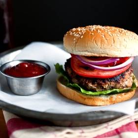

---
categories:
- 135D8DF8-5165-487A-9161-61345003AB1B
- DF723BE7-257E-4E0F-B4AA-BD8B0311B3D8
- 7CD3F8E9-6459-40C0-8802-20549A6F50EC
- 98E4F68D-11D7-4383-90FA-22C804880E1C
cook_time: 30 minutes
created: '2022-01-11 09:04:10'
difficulty: ''
hash: ea52f50b7afcb07cf31f2623347bdbf915f723aed82a54c2e3edd483a62d0feb
image_url: https://static01.nyt.com/images/2014/04/02/dining/Turkey-Burgers/Turkey-Burgers-articleLarge.jpg
in_trash: false
is_pinned: false
on_favorites: false
on_grocery_list: false
prep_time: ''
rating: 0
scale: null
servings: Yield 4 burgers
source: cooking.nytimes.com
source_url: https://cooking.nytimes.com/recipes/1016139-turkey-burgers
total_time: ''
uid: 8C56E515-F9C6-4BAB-8730-2D4F82B26F3A
---

# Turkey Burgers

## Ingredients

- FOR THE BURGERS:
- 1/2 medium onion
- 2-3 garlic cloves
- 1 lb lean ground turkey
- 1 tbsp Worcestershire sauce
- 2 tbsp ketchup
- 3/4 tsp salt
- Freshly ground pepper to taste
- 4 hamburger buns, preferably whole wheat
- 1 tbsp canola oil, or use pan spray
- FOR SERVING:
- Sliced red onion
- Sliced avocado
- Sliced red pepper

## Directions

Grate the onion on the fine holes of a grater. You should have about two tbsp of grated onion (and a lot of juice, which you can discard). Place in a bowl with the ground turkey, Worcestershire sauce, ketchup, salt and pepper. Using a fork, mix together well. Shape into four patties — the mixture will be quite moist — and press the patties into 1/2-inch thick rounds.

Heat the canola oil in a nonstick griddle or large nonstick frying pan over medium-high heat. (Alternately, spray the griddle or pan with pan spray.) When you can feel the heat while holding your hand just above griddle or pan, cook the patties for five minutes on each side. Serve on buns, with the condiments of your choice.
