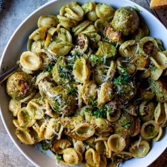

---
categories:
- 135D8DF8-5165-487A-9161-61345003AB1B
- DF723BE7-257E-4E0F-B4AA-BD8B0311B3D8
- 460F3A6B-0B87-457B-AF84-A1CE51D92D74
- 2BBE169B-4709-4377-8F54-765FFAAD9E1A
cook_time: 1 hour
created: '2022-09-18 09:21:37'
difficulty: ''
hash: fadfd50f013f5a9702fb4a5d00232d4a37a126f67b8253def397b5fec743dd02
image_url: https://i1.wp.com/smittenkitchen.com/wp-content/uploads/2022/09/turkey-pesto-meatballs-11-scaled.jpg?w=1920&ssl=1
in_trash: false
is_pinned: false
on_favorites: false
on_grocery_list: false
prep_time: ''
rating: 0
scale: null
servings: 'Servings: 4'
source: smittenkitchen.com
source_url: https://smittenkitchen.com/2022/09/turkey-pesto-meatballs-and-orecchiette/
total_time: ''
uid: 252AAC31-7C6C-4FF9-87C2-7DA077064C3B
---

# Turkey Pesto Meatballs and Orecchiette

## Ingredients

- Olive oil
- 1 pound (455 grams) ground turkey
- 1/2 cup panko, or another plain, dry breadcrumb
- 1 cup basil pesto, homemade or store bought, divided
- 4 garlic cloves, minced, divided
- 2 tablespoons grated parmesan, plus more to serve
- 1 tablespoon water
- Kosher salt
- Freshly ground black pepper
- 1 large egg
- 1 pound (455 grams) zucchini or summer squash, sliced into 1/4″ half-moons
- 1 pound (455 grams) dried orecchiette
- 2 cups chicken or vegetable broth (see Note)

## Directions

Heat your oven: To 450°F. Coat a large sheet pan with oil, or line it with nonstick foil for easier cleanup.

Prepared the meatballs: Combine turkey, panko, 1/4 cup of the pesto, half the minced garlic, 2 tablespoons grated parmesan, water, 1 teaspoon kosher salt, many grinds of black pepper, and the egg in a large bowl with a fork, mixing until just combined. Coat your palms lightly with olive oil and use a heaped tablespoon or 1.5-tablespoon scoop to measure the meatballs, rolling them briefly in palms to smooth them, and space them out on the prepared sheet pan.

Prepared the zucchini: Toss zucchini in a big bowl with 1 to 2 tablespoons olive oil, 1 teaspoon kosher salt, and lots of black pepper. Scatter zucchini around the meatballs on the tray.

Roast meatballs and zucchini:Transfer the tray to the oven and roast for 15 to 18 minutes, until meatballs are cooked through. For better color on top, transfer meatballs and vegetables to your oven’s broiler for 3 to 4 minutes.

Meanwhile, make the orecchiette: In a large pot of well-salted water, cook your pasta until 1 minute shy of done, so it still has a little bite left to it. Drain the pasta, reserving 1 cup pasta water [and up to 3 cups, if using the bouillon option, see Note up top].

Make brothy pesto and assemble: Heat empty pasta pot over medium-high heat and add 2 tablespoons of olive oil and 2 garlic cloves. Cook garlic until just golden at the edges, about 1 minute. Add 2 cups of broth and bring it to a simmer. Add 1/2 cup of remaining pesto, stir just until warmed. Transfer meatballs and zucchini to brothy pesto in the pot, and add drained pasta. Cook everything together, tossing to evenly coat, for 1 to 2 minutes.

Distribute meatballs, zucchini, and orecchiette to wide serving bowls, ladling over any pesto broth left in the pot. Finish each bowl with an additional spoonful of remaining pesto, more salt and pepper, and grated parmesan cheese. Eat right away.
