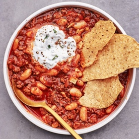

---
categories:
- 135D8DF8-5165-487A-9161-61345003AB1B
- DF723BE7-257E-4E0F-B4AA-BD8B0311B3D8
- 1A786DC7-9C26-4F71-B6F4-1B452FC14FB9
- 98E4F68D-11D7-4383-90FA-22C804880E1C
cook_time: ''
created: '2020-01-30 11:40:55'
difficulty: ''
hash: 630c432165c5fe78dc7675ac48adc6855fbd9a0e83ff6cd8e98b782362636ce7
image_url: https://assets.bonappetit.com/photos/5e2f8144fbb20b000996a9e0/16:9/w_1880,c_limit/HLY_0220_Chili.jpg
in_trash: false
is_pinned: false
on_favorites: false
on_grocery_list: false
prep_time: ''
rating: 0
scale: null
servings: 8 servings
source: bonappetit.com
source_url: https://www.bonappetit.com/recipe/turkey-and-bean-chili
total_time: ''
uid: 9925D9F9-9AA0-4529-8F5E-CFEC6A77A65C-8524-0000061D574FCA7F
---

# Turkey and Bean Chili

## Ingredients

- 4 cups low-sodium chicken broth
- 3 large or 6 medium ancho chiles
- 2 dried guajillo chiles
- 2 dried pasilla chiles
- 2 canned chipotle chiles in adobo
- 6 tbsp vegetable oil, divided
- 3 lb ground turkey, preferably dark meat
- Kosher salt
- 2 onions, finely chopped
- 5 garlic cloves, smashed
- 1 tbsp ground cumin
- 2 tsp dried oregano
- 2 tbsp tomato paste
- 1 (12 oz) bottle hard cider or lager-style beer
- 1 3" cinnamon stick
- 2 bay leaves
- 2 (15.5 oz) cans cannellini beans, drained, rinsed
- 3 tbsp pure maple syrup
- 1 cup plain Greek yogurt
- 2 tbsp fresh lime juice (from 1-2 limes)
- Handful of cilantro leaves and stems, finely chopped
- Freshly ground black pepper
- Tostadas (for serving)

## Directions

Bring broth to a simmer in a large Dutch oven or other heavy pot. Meanwhile, remove and discard stems from ancho, guajillo, and pasilla chiles. Tear flesh into a few pieces, letting seeds fall out. Transfer to a blender. Add hot broth and cover blender; let sit until chiles are softened, 25-30 minutes. Add chipotle chiles and blend on high speed until smooth, about 1 minute; set aside.

Heat 2 tbsp oil in same pot over medium-high. Season turkey all over with salt. Add half of turkey to pot and smash down with a wooden spoon to flatten against surface of pot and break into smaller clumps. Cook, undisturbed, until underside is browned, top side is no longer pink, and most of the liquid is cooked off, 8-10 minutes. Using a slotted spoon, transfer to a plate. Repeat with another 2 tbsp oil and remaining turkey.

Heat remaining 2 tbsp oil in same pot over medium. Add onions and garlic; season with salt and stir to combine. Cover pot and cook, stirring occasionally, until onions are translucent, very soft, and starting to brown around the edges, 10-12 minutes. Add cumin and oregano and cook, stirring frequently, until fragrant and sizzling, about 1 minute. Add tomato paste and cook, stirring to coat vegetables, until paste darkens slightly, about 1 minute. Add cider, cinnamon, and bay leaves and scrape up any brown bits stuck to bottom of pot (if you’re not using beer, skip this step and increase water in next step to 5 cups). Bring to a lively simmer and cook, stirring occasionally, until liquid is mostly reduced, about 5 minutes.

Add reserved chile purée, beans, and maple syrup. Add 4 cups water to blender, swish around to loosen any remaining purée, then pour into pot; season with salt. Bring to a boil, reduce heat to medium-low, and gently simmer, partially covered and stirring occasionally, until liquid is thickened and very flavorful, about 1 hour. Add turkey and simmer until flavors have melded, about 30 minutes longer.

Meanwhile, stir yogurt, lime juice, and cilantro in a small bowl to combine. Season to taste with salt.

Taste chili and season with salt and pepper if needed. Remove from heat and fish out cinnamon stick and bay leaves. Divide chili among bowls. Top with a dollop of yogurt-lime sauce and some broken tostadas.

Do Ahead: Chili (without yogurt sauce and tostadas) can be made 3 days ahead. Transfer to an airtight container and chill.
