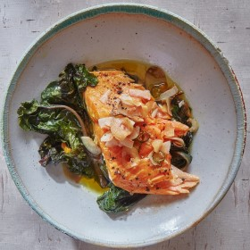

---
categories:
- 135D8DF8-5165-487A-9161-61345003AB1B
- 0E6E410A-45EC-4274-98C8-2190B87DB54A
- 1C21D75E-3CF2-4B23-B04F-A9275BC1033B
- 2BBE169B-4709-4377-8F54-765FFAAD9E1A
cook_time: ''
created: '2020-01-26 10:32:24'
difficulty: ''
hash: ba40804c7fc5e7d8e312d5da2971a942db867847761d328441515940ef0db70e
image_url: https://assets.bonappetit.com/photos/5df7e3a774d917000929589d/16:9/w_1880,c_limit/FGFP-Turmeric-Salmon-Coconut-Crisp%2016x9.jpg
in_trash: false
is_pinned: false
on_favorites: false
on_grocery_list: false
prep_time: ''
rating: 0
scale: null
servings: 4 servings
source: Bonappetit.com
source_url: https://www.bonappetit.com/recipe/turmeric-salmon-with-coconut-crisp
total_time: ''
uid: 7983ABAF-8730-4272-BADC-F687AD04AB10
---

# Turmeric Salmon with Coconut Crisp

## Ingredients

- 5 Tbsp. extra-virgin olive oil, divided
- 2 bunches Swiss chard, ribs and stems removed and finely chopped, leaves coarsely chopped (keep separate)
- 1 large shallot, thinly sliced
- 1 3" piece ginger, peeled, thinly sliced lengthwise
- Kosher salt
- ½ tsp. ground turmeric
- 1 1½-lb. skinless salmon fillet, preferably center cut
- 3 garlic cloves, thinly sliced
- ½ serrano chile, thinly sliced
- ½ cup unsweetened coconut flakes
- Freshly ground black pepper

## Directions

Preheat oven to 300°. Heat 2 Tbsp. oil in a large ovenproof skillet over medium-high. Add Swiss chard ribs and stems, shallot, and ginger and cook, stirring occasionally, until shallot is softened but not browned, about 3 minutes. Add Swiss chard leaves and cook, stirring, until partly wilted, about 3 minutes. Remove from heat and season with salt.

Combine 2 Tbsp. oil and turmeric in a small bowl. Place salmon, flat side down, on top of greens in skillet. Season salmon with salt and coat with turmeric oil. Transfer to oven and bake until fillet is just opaque in the center and flakes easily and greens are tender, 25–30 minutes.

Meanwhile, heat remaining 1 Tbsp. oil in a small skillet over medium. Add garlic, chile, and coconut flakes and cook, stirring often, until garlic and coconut turn golden, about 5 minutes. Transfer coconut crisp to a small bowl and season lightly with salt.

Season fish and greens with pepper; serve with coconut crisp for topping.
