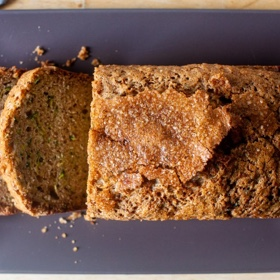

---
categories:
- 6BF378BD-8FD0-4FEF-9755-940308F0C8C7
- 60FB6093-F8C4-447B-A9A2-81A75BBCBA70
- E5311B89-BA3B-4153-9D9E-C809730BC236
- 2BBE169B-4709-4377-8F54-765FFAAD9E1A
cook_time: 1 hour 20 minutes
created: '2021-06-19 14:12:27'
difficulty: ''
hash: 0a5df21a77aa9bd06333ef3afd500ff11e9bca39a82370cbe90b35cff10a0624
image_url: https://i1.wp.com/smittenkitchen.com/wp-content/uploads//2019/08/ultimate-zucchini-bread.jpg?fit=750%2C500&ssl=1
in_trash: false
is_pinned: false
on_favorites: false
on_grocery_list: false
prep_time: ''
rating: 0
scale: null
servings: 'Servings: 8 to 10'
source: smittenkitchen.com
source_url: https://smittenkitchen.com/2019/08/ultimate-zucchini-bread/
total_time: ''
uid: 0219886C-CF6E-4389-9914-A664E3560E3E
---

# Ultimate Zucchini Bread

## Ingredients

- 2 cups (13 ounces or 370 grams) grated, packed zucchini, not wrung out, grated on the large holes of a box grater
- 2 large eggs
- 2/3 cup (160 ml) of a neutral oil (I use safflower), olive oil, or melted unsalted butter
- 1/2 cup (95 grams) packed dark brown sugar
- 1/2 cup (100 grams) granulated sugar
- 1 teaspoon vanilla extract
- 1 teaspoon fine sea or table salt
- 1 1/4 teaspoons ground cinnamon
- 1/8 teaspoon ground or freshly grated nutmeg
- 3/4 teaspoon baking soda
- 1/2 teaspoon baking powder
- 2 cups (260 grams) all-purpose flour
- 2 tablespoons (25 grams) raw or turbinado sugar

## Directions

Heat oven to 350 degrees F. Lightly coat a 6-cup or 9×5-inch loaf pan with nonstick spray. Place grated zucchini in a large bowl and add oil, eggs, sugars, vanilla, and salt. Use a fork to mix until combined. Sprinkle cinnamon, nutmeg, baking soda, and baking powder over surface of batter and mix until combined — and then, for extra security that the ingredients are well-dispersed, give it 10 extra stirs. Add flour and mix until just combined. Pour into prepared loaf pan and smooth the top. Sprinkle with the raw or turbinado sugar — don’t skimp. Bake for 55 to 60 minutes, until a toothpick or tester inserted into the middle cake but also into the top of the cake, closer to the dome, comes out batter-free.

Let cool completely in the pan. Leave in pan, unwrapped, overnight or 24 hours, until removing (carefully, so not to ruin flaky lid) and serving in slices. Zucchini bread keeps for 4 to 5 days at room temperature. I wrap only the cut end of the cake in foil, and return it to the baking pan, leaving the top exposed so that it stays crunchy.
