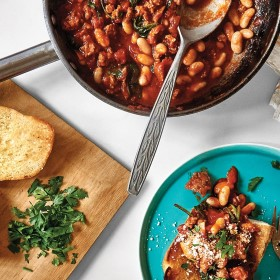

---
categories:
- A6695F02-BB88-4BF3-9B3A-4F3FB0ACFBBA
- DACC7E83-9563-43BB-A342-86C5AE800BA7
- 0B4EDF55-58AC-4E2F-9ACC-EA7C5317BA40
- 98E4F68D-11D7-4383-90FA-22C804880E1C
cook_time: ''
created: '2020-01-26 11:05:57'
difficulty: ''
hash: ca6ea096c656a5bcaede848329e74130cab7f36f4d5469c984677ae0ba5fad50
image_url: https://assets.bonappetit.com/photos/5c2e59a8441ed72d95964cf5/16:9/w_1880,c_limit/Weeknight-Beans-on-Toast.png
in_trash: false
is_pinned: false
on_favorites: false
on_grocery_list: false
prep_time: ''
rating: 0
scale: null
servings: 4 servings
source: Bonappetit.com
source_url: https://www.bonappetit.com/recipe/weeknight-beans-on-toast
total_time: ''
uid: 1312F8E6-7D81-42E7-8969-574C622EC42D
---

# Weeknight Beans on Toast

## Ingredients

- 2 Tbsp. extra-virgin olive oil
- 1 lb. sweet or hot Italian sausage, casings removed
- 5 garlic cloves, 3 thinly sliced, 2 finely grated
- ½ tsp. dried oregano
- ¼ tsp. crushed red pepper flakes (optional)
- 1 28-oz. can crushed tomatoes
- 3 tsp. kosher salt, divided, plus more
- 1 5-oz. package baby spinach, coarsely chopped
- 2 15.5-oz. cans white beans, rinsed
- 4 Tbsp. unsalted butter
- 1 12" crusty Italian sub roll, cut in half crosswise, split lengthwise, or 2 ciabatta rolls, split lengthwise
- 1 oz. Parmesan or Pecorino, finely grated
- Chopped parsley (for serving; optional)

## Directions

Heat oil in a large Dutch oven or high-sided skillet over medium-high. Add sausage and press down on it with a heatproof rubber spatula to flatten slightly. Cook, undisturbed, until browned underneath, about 4 minutes. Turn sausage over and cook, undisturbed, until browned on the other side, about 3 minutes. Break up sausage into bite-size pieces with spatula. Add sliced garlic, oregano, and red pepper flakes (if using) and cook, stirring, until garlic is beginning to get golden around the edges, about 1 minute. Carefully add tomatoes (beware of splatter!), then 2½ tsp. salt and 1 cup water. Bring sauce to a simmer and cook, stirring occasionally, until slightly reduced, 10–12 minutes. Mix in spinach and cook until wilted, about 2 minutes. Add beans and cook until warmed through, about 3 minutes. Taste ragù and season with more salt if needed.

Meanwhile, heat broiler. Melt butter in a small saucepan over medium heat. Mix in grated garlic and remaining ½ tsp. salt and cook until fragrant and sizzling but garlic is not yet browned, about 30 seconds; remove from heat.

Arrange bread, cut side down, on a foil-lined baking sheet and broil until golden brown, about 1 minute. Remove from broiler and turn bread over. Brush untoasted sides of bread with garlic butter and broil until evenly golden brown on top, about 1 minute (keep watch; it will go fast).

Divide toast among plates. Ladle a generous amount of ragù over and top with Parmesan and parsley.

Do Ahead: Ragù can be made 3 days ahead. Let cool; cover and chill. Reheat over medium-low.
