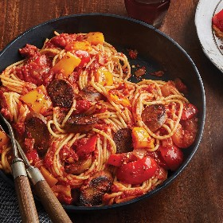

---
categories:
- 135D8DF8-5165-487A-9161-61345003AB1B
- DACC7E83-9563-43BB-A342-86C5AE800BA7
- 460F3A6B-0B87-457B-AF84-A1CE51D92D74
- 98E4F68D-11D7-4383-90FA-22C804880E1C
cook_time: ''
created: '2020-02-16 09:09:08'
difficulty: ''
hash: 98fb60a5264724e4c45c0a690c81d1012dff911308ccf07ea88a9d497ad05018
image_url: https://assets.bonappetit.com/photos/5dcdbc693417f4000888554c/16:9/w_1880,c_limit/0919-FIELD-ROAST15024-.jpg
in_trash: false
is_pinned: false
on_favorites: false
on_grocery_list: false
prep_time: ''
rating: 0
scale: null
servings: 'Serving size: 4 people'
source: Bonappetit.com
source_url: https://www.bonappetit.com/recipe/one-pan-weeknight-sausage-and-peppers
total_time: ''
uid: 0B77B6A2-BBEF-4C01-AF4E-F1AB773E760D
---

# Weeknight Sausage and Peppers

## Ingredients

- 1 (12 oz) package Italian Sausage, sliced into 1/4" rounds
- 1/4 cup extra-virgin olive oil
- 1 yellow onion, chopped
- 3 cups chopped multicolor bell peppers
- 4 garlic cloves, minced
- 1/2 tsp red pepper flakes, plus more for serving
- 1 (14 oz) can crushed tomatoes
- Spaghetti
- Kosher salt and freshly ground black pepper

## Directions

In large skillet, heat 2 tbsp olive oil over medium-high. Add onion; cook, stirring occasionally, until light golden, 5 minutes. Add bell peppers. Cook stirring occasionally until tender, 5 minutes. Add garlic, fennel seeds and red pepper flakes; cook, stirring occasionally until fragrant, 30 seconds. Salt and pepper to taste.

Push vegetables to edges of skillet. Add remaining 2 tbsp olive oil and Field Roast Plant-Based Italian Sausage in center of skillet. Cook until golden, 1-2 minutes. Stir to combine.

Add crushed tomatoes. Bring to a boil; reduce heat to medium-low. Simmer for 5 minutes. Salt and pepper to taste. Serve over spaghetti with red pepper flakes.
