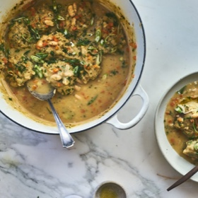

---
categories:
- 135D8DF8-5165-487A-9161-61345003AB1B
- F0D08EC3-D9EF-4F02-A381-FF3D38660DA6
- 1A786DC7-9C26-4F71-B6F4-1B452FC14FB9
- 98E4F68D-11D7-4383-90FA-22C804880E1C
cook_time: 25 mins
created: '2020-03-15 16:29:40'
difficulty: ''
hash: 038ae80a687a743b90f5d37d4900880d85369f1c482c81c51eddcfc2d471eb79
image_url: https://images.101cookbooks.com/white-bean-soup-with-pesto-dumplings-h.jpg?w=680&auto=format
in_trash: false
is_pinned: false
on_favorites: false
on_grocery_list: false
prep_time: 10 mins
rating: 0
scale: null
servings: '6'
source: 101cookbooks.com
source_url: https://www.101cookbooks.com/white-bean-soup-with-pesto-herb-dumplings/
total_time: ''
uid: 9C7519BD-7BDD-4260-BB22-1B3375402AC8-4240-00000178260885C8
---

# White Bean Soup with Pesto Herb Dumplings

## Ingredients

- White Bean Soup:
- 1 large onion, peeled and finely diced
- 2 carrots, peeled and diced
- 3 tablespoons extra-virgin olive oil
- 1 teaspoon caraway seeds, lightly crushed (optional)
- 1/2 cup whole wheat pastry flour
- 5 cups of water or vegetable broth
- 1 teaspoon fine grain sea salt, or to taste
- 14- ounce can cannellini beans, drained and rinsed
- Pesto Herb Dumplings:
- 1 cup almond milk (or whatever milk you like)
- 1 egg
- 2 tablespoons pesto
- 1 cup chopped herbs (dill, scallions, basil, lemongrass, etc.), plus more for serving
- 1 1/2 cups whole wheat pastry flour
- 2 teaspoons baking powder
- 1/2 teaspoon fine grain sea salt

## Directions

In a large, wide soup pot saute the onions and carrots in the olive oil over medium high heat. Cook until the vegetables are tender, 5-7 minutes. Stir in the caraway seeds, if using, and then sprinkle with the flour, stir, and allow to cook for another 2-3 minutes, allowing the flour to toast just a bit. Stir in the water, and salt, and bring to a gentle simmer, and cook until the soup thickens, 5 minutes or so. Stir in the beans. Allow to simmer gently while you make the dumplings.

In a mixing bowl, combine the almond milk, egg, and pesto, whisk well, until uniform, then add the herbs. In another mixing bowl whisk together the flour, baking powder, and salt. Pour the liquid ingredients into the dry, then stir with a large fork until just combined. Drop generous tablespoons of this dumpling mixture into the gently simmering soup. Resist the urge to make the dumplings larger than this, they will definitely blossom in size. It's fine if the dumplings are touching. Cover and cook for 7 minutes or so. Use a big spoon to flip each dumpling, and cook for another 7 minutes, or until cooked through. Serve hot, topped with more chopped herbs and scallions.

## Nutritional Information

Fat: 11 g
Calories: 299 kcal
Saturated Fat: 1 g
Sodium: 862 mg
Fiber: 8 g
Sugar: 2 g
Carbohydrate: 43 g
Cholesterol: 27 mg
Serving Size: 1 serving
Protein: 10 g
