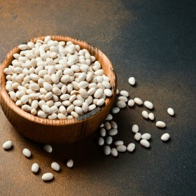

---
categories:
- A3FA97E2-41F7-4C28-8433-211311D4E130
- F0D08EC3-D9EF-4F02-A381-FF3D38660DA6
- 18EDB3A1-512C-4003-8EE4-AE58D58363B1
cook_time: ''
created: '2026-01-31 21:24:31'
difficulty: ''
hash: 185505b1253d26567ee4eb631753703fda2cdaf8a6cf2985354af8f6cfeab129
image_url: null
in_trash: false
is_pinned: false
on_favorites: false
on_grocery_list: false
prep_time: ''
rating: 0
scale: null
servings: ''
source: ''
source_url: ''
total_time: ''
uid: B207E53C-9F9A-485A-98F8-324CE7B3F80C
---

# White Great Northern Beans (Instant Pot)

Cooked from dried in the pot.

## Ingredients

- White Great Northern Beans

## Directions

Water + Beans, fill water several inches above beans.

25 min on high pressure, 15 min rest, then manual release the rest of the way.

## Notes

Do not salt water.
