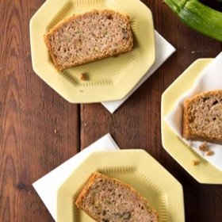

---
categories:
- 6BF378BD-8FD0-4FEF-9755-940308F0C8C7
- 60FB6093-F8C4-447B-A9A2-81A75BBCBA70
- E5311B89-BA3B-4153-9D9E-C809730BC236
- 2BBE169B-4709-4377-8F54-765FFAAD9E1A
cook_time: 60 minutes
created: '2020-04-21 09:53:04'
difficulty: ''
hash: 80f004a67c5e5defe090b9d88a01cdb24298e76fe083f823d5ce16982aa05740
image_url: https://www.pauladeen.com/wp-content/uploads/z/u/zucchini-bread_1.jpg
in_trash: false
is_pinned: false
on_favorites: false
on_grocery_list: false
prep_time: ''
rating: 0
scale: null
servings: 'Servings: 10'
source: pauladeen.com
source_url: https://www.pauladeen.com/recipe/zucchini-bread/
total_time: ''
uid: 4A08F2C9-6551-4DC7-A15A-743A0BEA731C-1833-000001755BD85532
---

# Zucchini Bread

## Ingredients

- 2 cups grated zucchini
- 1/3 cup water
- 4 beaten eggs
- 1 cup vegetable oil
- 3 cups sugar
- 1 tsp ground cinnamon
- 2 tsp baking soda
- 1 tsp ground nutmeg
- 1 1/2 tsp salt
- 3 1/4 cups all purpose flour
- 1 tsp lemon juice
- 1 cup chopped (or pecans) walnuts

## Directions

Preheat oven to 350°F. In a large bowl, combine flour, salt, nutmeg, baking soda, cinnamon and sugar. In a separate bowl, combine oil, eggs, water, zucchini and lemon juice. Mix wet ingredients into dry, add nuts and fold in. Bake in 2 standard loaf pans, sprayed with nonstick spray, for 1 hour, or until a tester comes out clean. Alternately, bake in 5 mini loaf pans for about 45 minutes. Makes 2 loaves.
