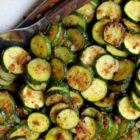

---
categories:
- 9B3E8F54-7F9D-4782-919F-ACC9A0850C87
- 60FB6093-F8C4-447B-A9A2-81A75BBCBA70
- 1C21D75E-3CF2-4B23-B04F-A9275BC1033B
- 98E4F68D-11D7-4383-90FA-22C804880E1C
cook_time: ''
created: '2023-07-15 13:33:32'
difficulty: ''
hash: 3abb415231926a4191e1075801284574e88901374e2dc5c8008d3326220f862d
image_url: https://static01.nyt.com/images/2019/07/31/dining/31food2/30COOKING-ZUCCHINI2-videoSixteenByNineJumbo1600.jpg
in_trash: false
is_pinned: false
on_favorites: false
on_grocery_list: false
prep_time: ''
rating: 0
scale: null
servings: 4 servings
source: cooking.nytimes.com
source_url: https://cooking.nytimes.com/recipes/9529-zucchini-with-shallots
total_time: 15 min
uid: D1433BAA-B102-4488-9F75-FB504518984A
---

# Zucchini with Shallots

## Ingredients

- 1 1/2 lb small zucchini
- 2 tbsp olive oil
- Salt and freshly ground pepper to taste
- 2 tbsp fresh bread crumbs
- 1 tbsp butter
- 2 tbsp chopped shallots
- 4 tbsp chopped parsley

## Directions

Rinse the zucchini and pat dry. Trim off the ends, but do not peel them. Cut into 1/8-inch slices.

Heat the oil in a nonstick skillet and when the oil is hot, add the zucchini. Saute the zucchini over high heat, shaking the pan and tossing gently. Add salt and pepper, and cook a total of 5 minutes.

Add the bread crumbs and butter to the pan. When the crumbs start to brown, add the shallots and cook for another minute, tossing. Serve sprinkled with parsley.

## Nutritional Information

Trans Fat: 0 g
Fat: 10 g
Calories: 124
Saturated Fat: 3 g
Unsaturated Fat: 7 g
Sodium: 445 milligrams
Sugar: 5 g
Fiber: 2 g
Carbohydrate: 7 g
Protein: 3 g
